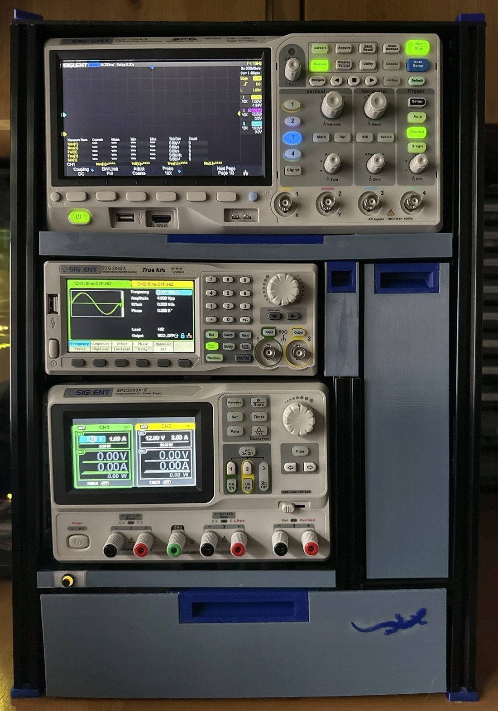
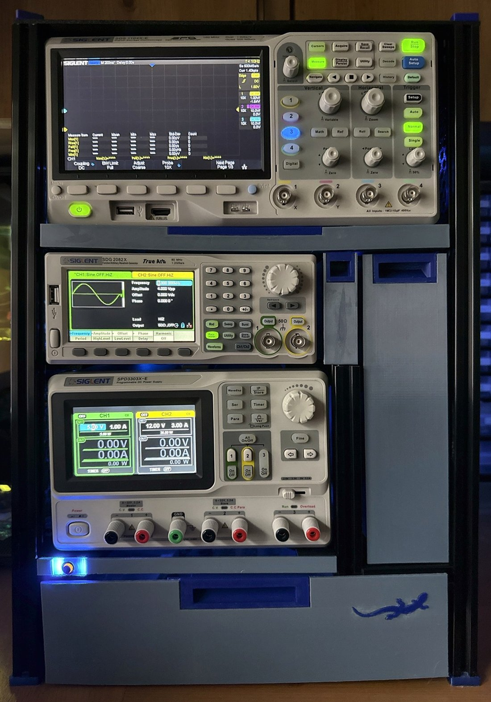
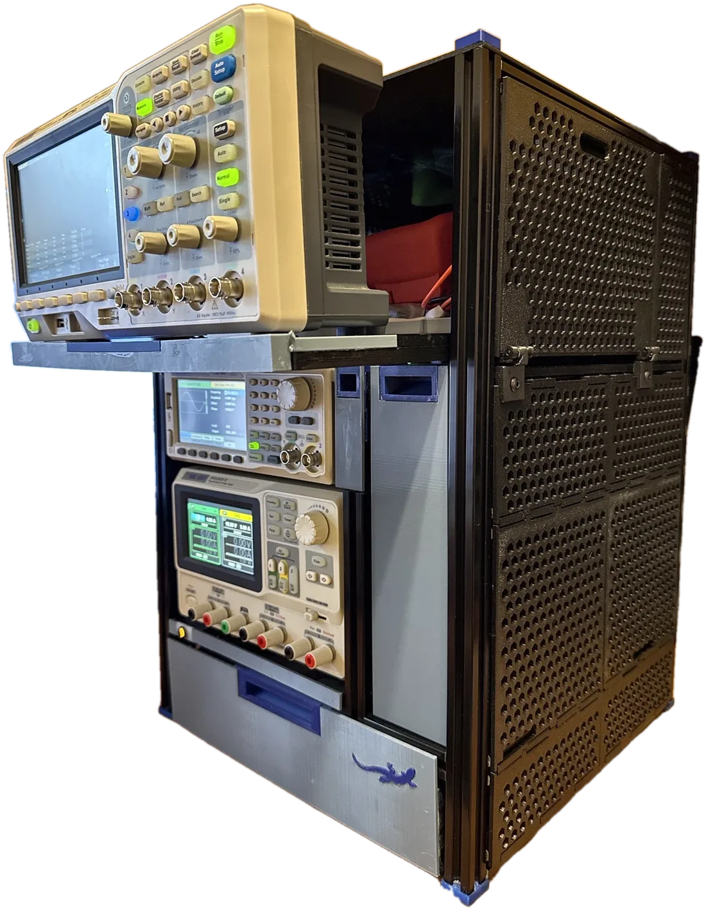
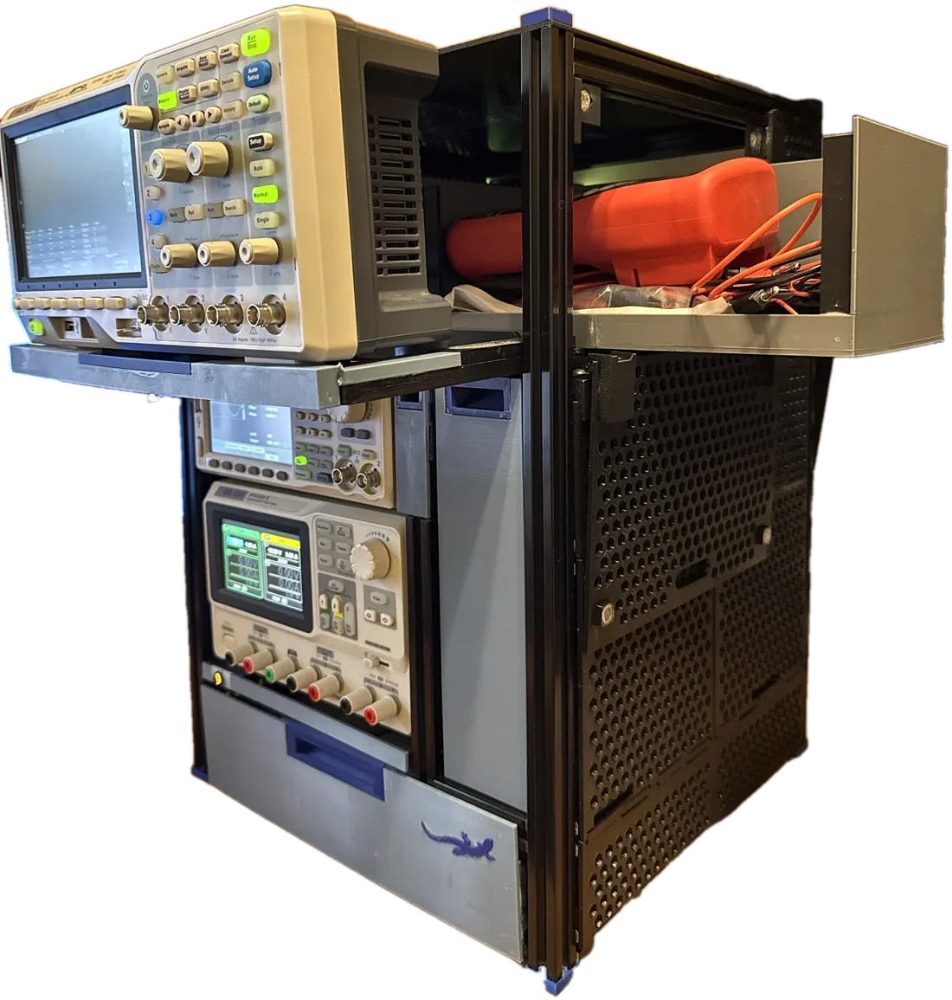

# SiglentTower

**A bench tower for three Siglent instruments: a 2020-extrusion frame with 103 3D-printed parts, designed in CadQuery, proven by boolean intersection before printing, and built in seven weeks on a Bambu X1C.**

<p align="center">
  
</p>

<p align="center">
  
  
  
</p>

## What it is

Three Siglent instruments — SDS1104X-E scope, SDG2082X AWG, SPD3303X-E PSU — stacked on a bench 350 mm wide with shelves directly above and 60 mm free behind. Nothing can be lifted out, so everything comes out forwards or sideways:

- **The scope rides a sled.** Printed T-feet in the scope rails' slots carry two split beams; the scope pulls forward 92 mm on them. Behind it, on the same sled, a **storage box** for the multimeters and leads comes out sideways through a fold-down door in the right-hand skin.
- **Three drawers** on printed runners: a full-width bottom drawer (315 × 300, printed as four dovetailed quarters because the bed is 256 mm), a column drawer beside the PSU and AWG, and a slim slot beside the AWG that leaves its fan vent a 15 mm air channel.
- **A clip-on skin** of hex-perforated tiles that spring into the extrusion slots, a top panel of four glued half-lapped tiles, and a door on printed hinges with magnet catches.
- **Backlighting**: two addressable LED strips on the rear uprights and two pixels in the front sill with a push button, run by **SiglentGlow**, my own ESP32-S3 firmware with a web page and Home Assistant over MQTT.

Every interface between aluminium and instrument is printed: the cradles that seat the PSU's feet and the AWG's pads, the runners, the sled, the clips, the hinges, the pulls, the feet.

| | |
|---|---|
| Frame | 362 × 350 × 510 mm, black 2020 extrusion, 8 × 1 m plus a 300 mm pack, cut on the bench |
| Printed parts | 76 designs, 103 pieces — PETG, ABS, ABS+ and TPU, one Bambu X1C, one plate a night |
| Design | 30 CadQuery part scripts, one `fit.py` of clearances set by nine coupons |
| Build | 2026-09-15 (first coupon) to 2026-11-03 (lights on) |
| Firmware | SiglentGlow on a XIAO ESP32-S3, FastLED, IguanaPlatform (its own repository) |

## How it was designed

**Coupons before parts.** Nine small test prints (P1–P9: the sliding foot, the cradle cup, the drawer runner, the tile clip, the hinge, the pull, the dovetail joint, the TPU foot, the scope's bumper cup) set every clearance on rail offcuts before anything printed full size. Each coupon is a literal section of its production part, and its result lives in one file, [`src/fit.py`](src/fit.py), that every part script reads. The runner clearance is 0.3 because a 300 mm runner slid well at 0.3; the tile barb is 1.2 with a 45° hook because 0.6 and 0.9 fell out.

**Proof before printing.** Every part is checked against the frame and its neighbours by boolean intersection — 0 cm³ in place, then shifted 0.5 mm each way to show it is located and held — in the `*_check.py` scripts. The checks did not catch everything (a bracket drawn with its bolt hole in empty space, a chiral part exported from a mirrored frame), and the bench did; both became rules.

**Print-oriented design.** [`PRINT-RULES.md`](PRINT-RULES.md): a part's bed face is chosen before it is modelled, precision surfaces are vertical walls, nothing hangs below the bed face, overhangs are designed out rather than supported, and [`src/printcheck.py`](src/printcheck.py) runs on every export. The rules were written as the mistakes happened and each one says which.

**Measured, not assumed.** The rails came out up to 6 mm from the spacer heights, the sub-frame 2.7 mm right of the model and the PSU's feet 155.5 mm apart rather than the datasheet's figure; the tiles, the sill panel and the cradles were re-cut to the bench, not the model.

The CAD, the check scripts, the sheets and the paperwork were written by Claude (Cowork for the design, Claude Code for the firmware and the as-built record) from measurements and decisions taken at the bench; the roadmap was the shared to-do list between the two.

## Repository map

| Path | What it is |
|---|---|
| [`HANDOVER.md`](HANDOVER.md) | **Start here.** The tower as built: every level, part, clearance and decision, with a parts index of every STL fitted |
| [`ROADMAP.md`](ROADMAP.md) | The build log: stages, print jobs, what failed and what replaced it, decisions D1–D15, coupon results |
| [`PRINT-RULES.md`](PRINT-RULES.md) | The print rules and the design-for-print review of every part |
| [`CUT-TABLE.md`](CUT-TABLE.md) | The extrusion cut sheet, by jig setting |
| `src/fit.py` | Every tuned clearance and measured dimension, with the coupon that set it |
| `src/parts/*.py` | One CadQuery script per part; `python src/parts/<part>.py` exports its STL(s) and runs the print check |
| `src/*_check.py` | The boolean proofs: parts against the frame and each other |
| `parts/` | The exported STLs and the check sheets (PNG), by area: `drawer/`, `column/`, `mini/`, `door/`, `tiles/`, `top/`, `sill/`, `inserts/`, `tpu/`, `wiring/` |
| `coupons/`, `jigs/` | The nine coupons and the assembly jigs (rail spacers, seating jigs) |
| `bambu/` | Bambu Studio projects for the plates that were printed, one a night |
| `publish/` | **`SiglentTower-complete.3mf`** — every part on 36 plates in one Bambu Studio project, grouped by filament, jigs last (`src/publish_3mf.py` makes it); `PLATES.md` lists the plates and the settings to set when slicing; `plates-sheet.png` shows every layout |
| `parts/wiring/` | The lighting: every connection, the runs on the frame, the perfboard hole by hole, the board enclosure |
| [`bench-stack-3d.html`](bench-stack-3d.html) | Interactive 3D model of the tower as built (three.js, self-contained): sliders for the drawers, the sled, the box and the door |
| [`bench-stack-layout-v16.pdf`](bench-stack-layout-v16.pdf) | The dimensioned layout as built: front and side elevations, plan, levels, cut list |
| [`frame-assembly-3d.html`](frame-assembly-3d.html) | Step-by-step viewer of the frame assembly |

## Building one

1. Read [`HANDOVER.md`](HANDOVER.md) §1–§9 for what the tower is, then §10 for the parts index: every STL, its material, its orientation and the hardware it takes.
2. Cut the extrusion from [`CUT-TABLE.md`](CUT-TABLE.md); the rail heights come from the printed spacers at assembly, not from the cuts.
3. Print the 36 plates of `publish/SiglentTower-complete.3mf` in order — they are grouped by filament, with the `SiglentTower fit 0.20` profile described in [`ROADMAP.md`](ROADMAP.md) §2 on every plate and the few settings the file cannot carry listed in `publish/PLATES.md`. TPU prints once, last.
4. Assemble per the frame viewer and the sheets under `parts/`; wire the lighting from `parts/wiring/wiring-4-connections.png`.

A step-by-step build guide and a write-up are the remaining close-out items (ROADMAP Stage 9).

## Running the scripts

```bash
pip install cadquery          # CadQuery 2.8 was used
python src/parts/sled_foot.py # exports parts/sled-foot-210.stl and runs printcheck on it
python src/sled_check.py      # proves the sled parts against the frame
python src/wiring_connections.py   # redraws parts/wiring/wiring-4-connections.png
```

## Status

Built and in daily use since 2026-11-03. Not built, by choice: a probe hanger and the rear cable clips. Open: the Stage 9 close-out above.

---

*Gareth Cooke · IguanaWare · [garethcooke.com/projects/siglenttower](https://garethcooke.com/projects/siglenttower)*
