# SiglentTower — the build guide

How to build the tower from nothing: what to buy, what to cut, what to print, then the build in order, each step as numbered actions with the check that says it is right. Every number comes from the as-built record, [`HANDOVER.md`](../HANDOVER.md), or from `src/fit.py`. This document says *what to do*; HANDOVER says *why it is so*, and [`ROADMAP.md`](../ROADMAP.md) is the story of how it got there. You should not need either to build the tower.

Written 2026-11-08 against HANDOVER v19 (the tower as it stood on 2026-11-03, built and working).

**Contents:** [0 Before you start](#0-before-you-start) · [1 Shopping list](#1-shopping-list) · [2 Tools](#2-tools) · [3 Cutting the extrusion](#3-cutting-the-extrusion) · [4 Printing](#4-printing) · [5 The frame](#5-the-frame) · [6 Measuring your frame](#6-measuring-your-frame) · [7 Cradles and instruments](#7-cradles-and-instruments) · [8 Drawers](#8-drawers) · [9 The sled and the box](#9-the-sled-and-the-box) · [10 The skin](#10-the-skin) · [11 Trim](#11-trim) · [12 Lighting (optional)](#12-lighting-optional) · [13 Checks before you call it done](#13-checks-before-you-call-it-done) · [14 If something does not fit](#14-if-something-does-not-fit)

---

## 0. Before you start

**What this is, and is not.** These parts fit **one particular frame** — the one cut and bolted together on the author's bench in September 2026 — and were fitted to that frame as it came out, not to the drawing. Its rails ended up as much as 6 mm from the heights the spacers were meant to set, the inner sub-frame 2.7 mm right of the model, the PSU's feet 155.5 mm apart rather than the catalogue figure. The side tiles were cut to the measured gap on each side, two cradles reprinted to where the feet landed, the sill panel shortened to the sub-frame as built. Yours will come out differently, so the build has a step this one added — **measuring your frame** (chapter 6) — and you should expect to re-export and reprint the side tiles, and possibly the sill panel, the top panel and a cradle. Every part is a Python script with its numbers in one place, so that is a measurement typed into a file and one command, not a redesign. Nothing about the frame, the drawers, the sled, the box, the door or the lighting depends on those measurements.

**Your instruments.** The tower was built round three Siglents, and these parts are specific to them; everything else only cares about the frame.

| Part | Specific to | Would change with another instrument |
|---|---|---|
| PSU cradles (four cups) | SPD3303X-E — feet Ø16.8 at the pad, Ø19.5 at 4 mm up, 155.5 apart across, 48 from the front and 34 from the rear of a 284.5 body; 150 tall on its feet | cup size, cup spacing and front-to-back position (`src/parts/psu_cradle.py`, `src/jigs/seating_jigs.py`) |
| AWG cradles; the mini slot's vent neck | SDG2082X — body 207 × 82 × 260 with handle and bumpers off; a Ø80 fan vent each side centred 123 behind the front | arm height (the AWG's underside is 3 mm above the PSU's top), pad positions, the 15 mm air channel the slot leaves beside the right vent |
| The sled's rear cups and front pockets | SDS1104X-E — D-shaped rear bumpers 25.9 × 24.0, flat to the rear, centres 44.15 in from the bezel sides and 116.9 behind the face; front stands folded, 44 × 23.1 × 11.5 tall, 24.7 in from the sides and 10 behind the face; bezel 315 × 152; 2.6–3 kg | the cups and pockets in the beam front halves (`src/parts/sled_beam.py`); the beam spacing if the bezel is not 315 |
| The levels | the three heights and the 3 mm reveals between them | every rail height, so every spacer and tile |

**Time and cost, in round figures.** Seven weeks of evenings (2026-09-15, first coupon, to 2026-11-03, lights on), one plate printing most nights — 36 plates, the largest about 24 hours. About 2.5 kg of filament in four materials. The extrusion: 8 × 1000 mm of black 2020 plus four 300s, 40 hidden L-connectors, 8 cast brackets, about 70 M5 screws and 54 T-nuts. A 4-way power strip and three short IEC leads; the lighting parts if you want them.

**Coordinates.** HANDOVER, the sheets and this guide share one frame of reference, in millimetres: **x** across from the left upright's outer face (0) to the right upright's (361–362); **y** back from the front plane — the front uprights' front faces (0) — to the rear (350); **z** up from the bottom of the base rails (0) to the top of the uprights (510). Everything inside the frame starts 3 mm behind the front plane; the drawer fronts fill that 3 mm and sit flush with the uprights.

---

## 1. Shopping list

### Extrusion and connectors

| Item | Quantity | Notes |
|---|---|---|
| 2020 aluminium extrusion, black, 6 mm slot (5.9 mouth) | 8 × 1000 + 4 × 300 | cut list in chapter 3; the 300s supply the two 179.5 inner uprights and the three 70 ties |
| Hidden L-connectors for 2020 (inside-corner, with grub screws) | 40 | one per joint, on the faces that look into the frame; they enter a slot only from its end |
| Cast corner brackets, 2020 | 8 (5 fitted, 3 spare) | two M5 × 8 and two T-nuts each |
| Drop-in (spring) M5 T-nuts | 54 + 2 per cast bracket fitted | drop-in nuts go in as each part is fitted; slide-in nuts must be loaded before each rail closes a slot (chapter 5) |

### Screws, magnets, glue

Counted from HANDOVER §10. Button head = ISO 7380; both it and the countersunk take a 3 mm key.

| Item | Qty | Goes in |
|---|---|---|
| M5 × 10 button head | 47 | every printed part on a T-nut, plus 4 into the uprights' top bores for the caps (an M5 self-taps the 2020 bore) |
| M5 × 10 countersunk | 9 | 4 AWG right cradles, 3 mini-slot runner, 2 sled front rests |
| M5 × 12 button head | 2 | hinge frame leaves |
| M5 × 8 | 2 per cast bracket | the cast brackets |
| M3 × 10 button head | 4 | bottom drawer facia, from inside |
| Magnets Ø10 × 2 | 4 | door catch |
| Superglue (CA — cyanoacrylate; a gel is easiest) | 2–3 tubes | every sled tab and tongue, drawer dovetails, pull inserts, hinge pins, top-panel laps, TPU feet, box seam |
| PTFE dry lubricant spray | 1 | the sled feet in their slots |

Hinge pins are printed (`hinge-pins-v1`) — nothing to buy.

### Power and lighting

| Item | Qty | Notes |
|---|---|---|
| 4-way switched power strip with keyhole mounts | 1 | the brackets fit an **Addtam** 4-way (350 × 78 body, keyholes 249.5 apart on a line 29.2 from a long edge, Ø15 cable out of the bottom end); another strip needs `STRIP_KEYHOLE_*` in `src/fit.py` changed |
| IEC (C13) leads, 0.5 m | 3 | |
| *Lighting (optional, chapter 12):* Seeed XIAO ESP32-S3 Plus · SN74AHCT125N · SR3200 Schottky · 1000 µF capacitor · 2 × 330 Ω · 50 × 70 perfboard | 1 each | any WS2812 controller works; this is what SiglentGlow runs on |
| WS2812B strip, 30 LEDs/m, 15 LEDs | 2 | |
| WS2812D-F5 5 mm pixels | 2 | |
| 8 mm momentary button with blue LED, 4 pins, with its 10 mm AF nut | 1 | |
| 2.54 mm locking plug housings with crimp pins (2-, 5-, 3-, 3-pin) and matching headers | 1 set | |
| USB-A pigtail, ≤ 3.5 outside diameter | 1 (550) | |
| 28 AWG wire in red, black, green, blue, yellow; 24 AWG red and black | a few metres | |

### Filament (±30 %)

| Filament | Prints | Roughly |
|---|---|---|
| Black ABS+ — **one spool, reserved**, dried | the sliding pairs and long bars: sled T-feet and beam halves, drawer runners, column guide strips, mini-slot runner | 0.4 kg |
| Black ABS | cradles, cross bars, cable channel, splices, hinge leaves, magnet bracket and tab | 0.3 kg |
| Black PETG | 16 side tiles, door, fixed rear tile, top tiles, drawer quarters, column drawer, mini-slot body, front rests, hinge pins, board enclosure | 1.2 kg |
| Dark grey PETG | three drawer fronts, sled front bar, rear box, sill panel | 0.4 kg |
| Dark blue PETG | pull inserts, sled-bar liner, logo inlay, upright caps | under 100 g |
| Natural (clear) PETG | sill window | a few grams |
| Any PETG (hidden parts) | strip brackets, box braces, sill blocks (white is best), the jigs | under 200 g |
| Blue TPU 95A, dried | four feet, four AWG pads, two stop caps, six 240 slot covers | under 60 g |

---

## 2. Tools

- **Cutting:** a saw in a **cutting jig with a length stop** (the cut sheet is by jig setting), a deburring tool or fine file for every cut end, a square.
- **Measuring:** digital calipers (every reading in chapter 6 is face to face), a steel rule, a tape for the 321 / 510 checks.
- **Hex keys:** 3 mm for every M5 button head and countersunk, 2 mm for the M3s, the size your hidden connectors' grub screws take, and a **3 mm ball-end key** for the sill blocks' bolts, which are driven along the block through a key hole.
- **Drill bits:** Ø5.5 and Ø10 only if you print the strip brackets from a file without a bolt hole (`strip-bracket-upper-v2` and `lower-v5` have it).
- **Files and a craft knife:** a flat needle file for brims on tab flanks and the sill window's wire notch; a knife to lift tiles.
- **Glue and clamps:** superglue (CA) gel; small clamps or tape for the drawer dovetails and the top laps. **Scissors** for the TPU covers.
- **Lighting only:** soldering iron, crimp tool for 2.54 mm pins, strippers, heat-shrink, a multimeter.
- **Printer:** a Bambu X1C with AMS (256 × 256 bed, textured PEI) is what the plates are laid out for; an external spool holder for the TPU.

---

## 3. Cutting the extrusion

The cut sheet is [`CUT-TABLE.md`](../CUT-TABLE.md); three rules first.

**Labelling.** Tape-label the eight 1000s **A–H** and the four 300s **W, X, Y, Z**. The label goes at one end and that end never goes to the stop: feed the freshly sawn end against the stop so the label stays on the remainder. The finished piece is the one between stop and blade; the remainder is stock for the next step, never a finished piece (it is short by the kerf, which the sheet allows for).

**Accuracy.** ±0.5 mm is fine and ±1 mm survivable: the rail heights come from the printed spacers at assembly, not from the cuts. What matters: (1) pieces of one length match each other within about 0.3 — one jig setting per set gives you that; (2) ends square, because a crooked end seats the connector crooked and racks the frame; (3) **err short, never long** — a 510 at 509 costs 1 mm of reveal over the scope; 179.5 can be 179.

**Deburr every end as you go** — the sled feet and the tile clips will find any burr. Bundle each length with tape and write the length on it.

| Step | Jig | Cut from | Cuts | Pieces made | Bar left after |
|---|---|---|---|---|---|
| 1 | 200 | W | 1 | 1 × 200 — coupon rail (keep it as your test offcut) | W ≈ 98 |
| 2 | 179.5 | X, Y | 1 each | 2 × 179.5 — inner uprights | X, Y ≈ 118 |
| 3 | 70 | W, X, Y | 1 each | 3 × 70 — ties | scrap |
| — | — | Z | none | 1 × 300 whole — second test offcut | — |
| 4 | 510 | A, B, C, D | 1 each | 4 × 510 — uprights | A–D ≈ 488 |
| 5 | 321 | A, B | 1 each | 2 × 321 — rear cross rails | scrap |
| 6 | 310 | C, D (1 each), E, F (3 each), G (2) | 10 | 10 × 310 — side rails | G ≈ 376 |
| 7 | 307 | G (1), H (3) | 4 | 4 × 307 — inner rails (two used, two spare) | scrap |

**To end with:** 4 × 510 · 2 × 321 · 10 × 310 · 4 × 307 · 2 × 179.5 · 3 × 70, plus the 200 and the 300 offcuts to test printed parts against.

---

## 4. Printing

Every printed part is in one Bambu Studio project, **`publish/SiglentTower-complete.3mf`** — 36 plates in filament order, one material per plate, the jigs last. [`publish/PLATES.md`](../publish/PLATES.md) lists every object with its per-object settings; [`publish/plates-sheet.png`](../publish/plates-sheet.png) shows the layouts.

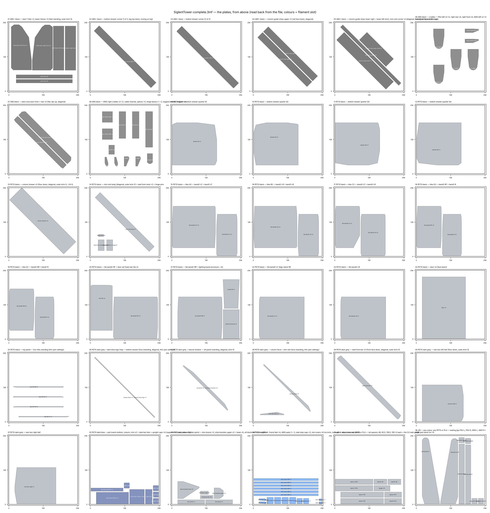

### Opening the project

1. Open `publish/SiglentTower-complete.3mf` in Bambu Studio 2.9.1 or later.
2. Set your spools against the five filament slots: **1** black ABS+ · **2** dark blue PETG · **3** black ABS · **4** PETG in the colour the plate's name says · **5** blue TPU 95A.
3. Check the process profile `SiglentTower fit 0.20` is on every plate. It is saved in the file: 0.20 layers, 4 walls, 5 top / 4 bottom, 40 % gyroid, precise Z, **X-Y compensation 0 / 0** (every clearance is in the parts), outer wall 80 mm/s, scarf seams, supports on but **"On build plate only"**, **skirt loops 0** (the column drawer leaves no room for one; parts that need first-layer help carry a brim).
4. Slice each plate before printing and look at the preview: **support on any sliding or mating face means something is wrong** — check the orientation against PLATES.md.

### What the file cannot carry — set these yourself

- **Dry the ABS+ and the TPU** first (65 °C, 6–8 h). Wet filament strings on the tab flanks and reads as "binds".
- **ABS and ABS+ plates (01–08): door closed.**
- **Thin standing parts, plates 25–28** (top tiles, bottom facia, sill panel, column and mini facias): skirt off, **bed 80 °C, part fan 30 % max**; the 15 mm brim and 60 mm/s outer wall are already set on those objects.
- **Counterbores facing the bed — plates 02, 03, 05, 06** (runners, cradles): Quality → Bridge counterbore holes → **Sacrificial layer**. The cups and counterbores print with a thin skin you punch out; nothing is supported inside a fit surface.
- **TPU (plate 34):** from the **external spool holder**, Generic TPU preset.
- **Calibrate** any non-Bambu spool (Calibration → Flow Dynamics, then Flow Rate): over-extrusion closes every 0.15 clearance.

**The thin-part warping note, in full.** The drawer fronts and the four top tiles are 3 mm sheets printed **standing on edge** (so both faces are wall finish and nothing needs support). The big bottom-drawer front — 315 × 83 on the diagonal — gave bed-adhesion trouble: warping at the ends and one spaghetti failure. What fixed it: **more heat and slower speeds** — bed 80 °C, outer wall 60 mm/s, part fan capped at 30 %, a 15 mm outer brim with 0 gap, skirt off, door closed. Brim, gap and speed are in the profile per object; bed and fan are filament settings you set yourself. Trim the brim off each sheet's bed edge afterwards.

### The order to print in

Print in plate order — that is the filament order, and the parts come off roughly as the build needs them. Two plates (26, 27) change filament mid-print by design (the facia's logo inlay, the sill's clear window); every other plate is one material.

| Plates | Material | Parts | Needed at |
|---|---|---|---|
| 35, 36 | any PETG or PLA — the **jigs** | rail spacers 48 / 63.5 / 139.5 / 159 (two each) + the 3.0 gauge; seating jigs PSU L / R, AWG L / R + four pad stand-ins | **first** — the spacers for chapter 5, the seating jigs for chapter 7 |
| 01 | black ABS+ | sled T-feet ×2, four beam halves | the feet go into the frame in chapter 5 |
| 02–05 | black ABS+ | drawer runners ×2, column strips ×4, mini-slot runner | chapter 8 |
| 06–08 | black ABS | cradles, cross bars, cable channel, splices, hinge leaves, magnet bracket and tab | 7, 9, 10 |
| 09–14 | black PETG | drawer quarters Q1–Q4 (one per plate), column drawer (~24 h), mini-slot body + front rests + hinge pins | 8, 9 |
| 15–25 | black PETG | side tiles, fixed rear tile, board enclosure, band 4 left, door, top tiles | 10 — **not until chapter 6 is done** |
| 26–28 | dark grey (+ blue, + natural) PETG | bottom facia with logo, sill panel with window, column and mini facias | 8, 11 — the sill panel after chapter 6 |
| 29–31 | dark grey PETG | sled front bar, rear box halves | 9 |
| 32 | dark blue PETG | pull inserts ×3, sled-bar liner, upright caps ×4 | 8, 10 |
| 33 | any PETG | box braces, strip brackets, sill blocks | 9, 11 |
| 34 | blue TPU | feet, AWG pads, stop caps, slot covers — **once, last** | 11 |

The top-panel plate (25) is the largest, 386 cm³: if four 180-tall standing sheets look wrong in your preview, print FL + FR one night and RL + RR the next. **Before assembly, trim brims off every tab and dovetail flank** — a brim left on a tab fakes the fit.

---

## 5. The frame

**Have ready:** the cut extrusion; the spacer set (plate 35 — two each of 48, 63.5, 139.5, 159, and the 3.0 gauge); the two sled T-feet (`sled-foot-210`, plate 01); 40 hidden L-connectors; 8 cast brackets with 16 M5 × 8 and 16 drop-in T-nuts; a square; a tape.

**The method.** Each side of the frame is built **flat on the bench with all five of its rails at once**, because a hidden L-connector enters a slot only from its end — once a rail sits between two uprights, nothing more can be added between them. The rail heights come from the printed spacers stood on the rail below. Then the two sides are stood up and joined by the two rear cross rails, and the inner sub-frame is built as a ladder and slid in from the front. The step-by-step viewer **[`frame-assembly-3d.html`](../frame-assembly-3d.html)** (open it in a browser; drag to turn, use the step slider) shows every piece going in, with the spacers and feet where they are used.

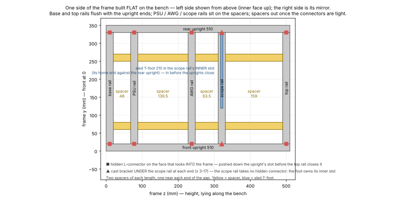

**Where the connectors go.** Hidden L-connectors go on the faces that look **into** the frame — side rails to uprights on the uprights' inner faces (x 20 and x 341), the rear cross rails to the rear uprights on their front faces, the inner rails to the inner uprights on their right faces, the ties on their front faces — never on an outer face, where the tile clips live. The **scope rails take no hidden connector**: the sled foot owns their inner slot and the tile clips the outer, so each scope rail sits on a **cast bracket under each end**, bolted into the rail's bottom slot and the upright's face at x 3–17. One more cast bracket lies flat between the front tie and the right PSU rail. The rest of the 42 joints are hidden connectors; three cast brackets are spare — if the finished frame wobbles, they go under the PSU rails' rear ends.

**T-nuts.** If yours are drop-in (spring) nuts, ignore this and drop them in as each printed part is fitted. If they are slide-in nuts, load them before each rail closes a slot: each base rail's top slot 6, each PSU rail's top slot 4 and bottom slot 2, the left AWG rail's top slot 4, the right AWG rail's top slot 2, the inner AWG-level rail's left-face slot 4 and top slot 3, the right PSU rail's and right AWG rail's inner-face slots and both inner rails' right-face slots 3 each, each scope rail's bottom slot 2 and the right scope rail's outer slot 2.

### 5.1 The left side, flat

Work on a flat bench. "Inner face" means the face that will look into the frame — for the left side, build it with that face up.

1. Lay a 510 upright down for the front and a 510 for the rear, inner faces up, 310 apart (so the rails fit between them).
2. Push 4 hidden L-connectors down each upright's inner-face slot from the top end, one for each of the base, PSU, AWG and top rails (the scope rail takes none), and slide them roughly to z 20, 88, 247 and 490.
3. Drop two T-nuts into each scope rail's **bottom** slot (for the cast brackets) and, if you use slide-in nuts, load every other slot per the list above.
4. Slide one sled T-foot (`sled-foot-210`) into the **inner-face slot** of a 310 scope rail — the slot that will face into the frame — and push it to the rear end of the rail. Leave it loose; it stays in the rail for good.
5. Lay the base rail (310) between the uprights, flush with their bottom ends, and engage its connectors; leave the grub screws loose.
6. Lay the top rail (310) between the uprights, flush with their top ends, and engage its connectors; loose.
7. Stand the two 48 spacers on the base rail, one near each upright, and lay the PSU rail on them with its connectors engaged.
8. Stand the two 139.5 spacers on the PSU rail and lay the AWG rail on them, connectors engaged.
9. Stand the two 63.5 spacers on the AWG rail and lay the scope rail (with its foot in) on them, cast brackets in its bottom slot at each end, foot's slot facing up (into the frame).
10. Stand the two 159 spacers on the scope rail and check the top rail lands on them; if it does not, your 510s or 310s are off — see the check below.
11. Square the side (measure both diagonals of the big rectangle; shift until they agree within 1 mm) and tighten every grub screw and the cast brackets' M5 × 8s, pressing each rail down onto its spacers as you go.
12. Lift the spacers out. If one is trapped, loosen that rail's connectors a quarter turn, slide it out, retighten.

**Check:** the two diagonals equal within 1 mm; the uprights' ends flush with the base and top rails; every spacer came out without force; the foot slides the full length of the scope rail's slot by hand. **What a failure looks like:** a spacer that will not come out means the rail above it was tightened while cocked — loosen and re-seat; a foot that sticks means a burr at a cut end — file it.

### 5.2 The right side, flat

13. Build the right side the same way (steps 1–12) as the **mirror image** — its inner face is the one that will face left, so lay the uprights with that face up and check twice that the scope rail's foot slot faces into the frame.
14. On the right scope rail, drop 2 T-nuts into the **outer** slot as well if your nuts are the slide-in kind (the hinge frame leaves bolt there later; drop-in nuts can wait).
15. On the rear-right upright, push 2 hidden L-connectors down the **front-face** slot before the top rail closes it — these take the two rear ties of the sub-frame.

### 5.3 Join the sides

16. Stand both sides up, inner faces toward each other, 321 apart at the rear (the rear cross rails are 321).
17. Engage a 321 rear cross rail between the rear uprights at the base, on the uprights' **front** faces, flush with the base rails' bottoms; tighten.
18. Engage the second 321 rear cross rail between the rear uprights at the top, flush with the top; tighten.
19. Square the frame on the bench: measure the two diagonals across the front opening and across the top, shift until each pair agrees within 1 mm, then check the clear width is 321 at the **front** as well as the rear (there is no front cross rail to hold it).

**Check:** diagonals equal within 1 mm; 321 clear between the uprights' inner faces at the front and the rear, top and bottom; 510 overall height; the frame does not rock on a flat bench and does not wobble when pushed at the top.

### 5.4 The inner sub-frame

The sub-frame is a ladder: two 307 inner rails (PSU level and AWG level) between two 179.5 inner uprights, with three 70 ties bolted on — PSU-level front, PSU-level rear, AWG-level rear — that reach from the ladder to the right-hand side rails. It stands at x 251–271 in the model, flush with the front plane.

20. Lay the two 179.5 inner uprights parallel, 307 apart, and engage a 307 inner rail between them at each end, the rail's outer face flush with the uprights' ends (so the ladder is 347 long and 179.5 tall, and in the frame its rails will sit at z 68–88 and 227.5–247.5), connectors on the inner rails' **right** faces; tighten.
21. Bolt the three 70 ties to the ladder: one at the PSU-level rail's front end and one at its rear end, one at the AWG-level rail's rear end, each on the tie's **front** face with a hidden L-connector (the front tie's outer end will take a cast bracket instead; leave its connector out).
22. Slide the ladder into the frame from the front, ties toward the right side, until its front upright is flush with the front plane.
23. Stand a 48 spacer under the rear inner upright on the base rear cross rail — that sets the PSU-level inner rail at z 68.
24. Engage the two rear ties into the connectors you pre-loaded in the rear-right upright's front-face slot (step 15), with the ties' tops flush with the right PSU rail's top (z 88) and the right AWG rail's top (z 247.5); tighten.
25. Fit the flat cast bracket between the front tie's rear face and the right PSU rail's inner face at y 23–43, z 68–88 (two M5 × 8 into T-nuts); tighten.
26. Lift the 48 spacer out.

**Check:** the sub-frame's front upright is flush with the front plane and plumb; the PSU-level inner rail's top is at 88, level with the right PSU rail's top; the AWG-level inner rail's top at 247.5; the three ties' tops flush with the side rails they meet. Push the frame at a top corner: no wobble. If it wobbles, bolt a spare cast bracket under each PSU rail's rear end (a bracket under a rail must stay at x 0–20 so the drawer clears it).

### 5.5 Trial-fit the instruments

27. Stand the PSU on blocks inside the frame so its underside is at z 91 (the blocks on the base rails), its face 3 mm behind the front plane, against the left PSU rail.
28. Stand the AWG on blocks so its underside is at z 251.5, face 3 behind the front plane, body 26.5 in from the left.

**Check:** a 3 mm reveal between each face and the front plane; the two screens' left edges in line; the PSU's rear fan clear of everything; the AWG's side vents uncovered; the AWG's underside 3 above the PSU's top. Take the PSU and AWG out again — the cradles go in next, after you have measured the frame.

---

## 6. Measuring your frame

This is the step this build added. The tiles, the sill panel, the top panel and the cradles were all cut to the frame as it was measured, not as it was drawn; yours will differ, so measure before you print any of them (plates 15–28 in the print order).

### Take these readings with calipers, face to face

29. **Rail gaps, each side, front and rear of each gap** (eight readings a side): base rail top → PSU rail underside; PSU rail top → AWG rail underside; AWG rail top → scope rail underside; scope rail top → top rail underside. The design values are 48 / 139.5 / 63.5 / 159. The as-built frame read right 45.4 / 139.5 / 65.8 / 158 and left 51.2 / 135 / 65.5 / 157 — up to 6 mm off, which is why the tiles are per side. Read to 0.1 mm: a tile has to match its band within about 0.2 to snap in.
30. **The sub-frame**: from the left upright's **inner** face to the sub-frame's front upright's **left** face (the model says 231; the as-built read 233.7, so that face was at x 253.7).
31. **The frame's width** by tape, outer face to outer face (the model says 361; the as-built taped 362).
32. **The rail-to-beam gap** comes later (chapter 9) — note here that the front rests exist in six sizes for it.

### What each reading changes

| Reading | Part | Where the number lives | What to do |
|---|---|---|---|
| Rail gaps, bands 1–3 (base→PSU, PSU→AWG, AWG→scope), per side | the 14 side tiles | `src/parts/side_tile.py`, the line `GAPS = {"L": {1: 51.2, 2: 135.0, 3: 65.5}, "R": {1: 45.4, 2: 139.5, 3: 65.8}}` | replace the six numbers with yours (front and rear of a gap should agree; if not, the rail is tilted — re-seat it or use the mean) |
| Scope→top gap, left | the two band-4 left tiles | `src/parts/band4_left.py` — the tiles run z 335–500 and hang from the top rail by their fingers, with 2–3 mm spare above the scope rail whether the gap reads 157 or 159 | nothing unless your gap is outside 155–160; then move `Z0` so the tile's bottom stays 3 above the scope rail's top |
| Scope→top gap, right | the door and the fixed rear tile | the fixed tile has a bolted leg that adjusts in z; the door hangs from the hinge | nothing |
| Sub-frame upright's left face | the sill panel | `src/parts/sill_panel.py`, the line `PX0, PX1 = 20.0, 253.4` | set `PX1` to your face position minus 0.3 |
| Frame width | the top panel | `src/parts/top_panel.py`, the line `PX0, PX1, PY0, PY1 = 0.0, 362.0, 0.0, 350.0` | set `PX1` to your width (the corner holes are 1.5 mm slots, so 361–363 all fit the 362 panel as it is) |
| PSU feet spacing and where they land (chapter 7) | the PSU cradles | `src/parts/psu_cradle.py`, `REACH_V3`, `REACH_V4R`, `REACH_V5RF` | only if a foot lands on a cup's rim rather than in it — see chapter 7 |

The column drawer, the mini slot and their runners are placed from the sub-frame's own rails, so the sub-frame's position does not move them. The frame itself, the drawers, the sled, the box and the door do not depend on any of these readings.

### Re-export — what to type

You need Python 3 with CadQuery (version 2.8 was used), trimesh and matplotlib. In a terminal, in the repository's folder:

33. `pip install cadquery trimesh matplotlib` — once.
34. Open the file named in the table above in any text editor, change the number, save.
35. `python src/parts/side_tile.py` — exports the 14 tiles to `parts/tiles/` as `tile-band…-v2.stl` and prints each one's size and a print check.
36. `python src/skin_check.py` — proves every tile against the frame at your gaps; every line should end 0 cm³ and "held".
37. `python src/tiles_plates.py` — repacks the tile plates A2–E2 from the new tiles (each line should say "fits").
38. `python src/parts/sill_panel.py` — the sill panel, window and blocks to `parts/sill/`.
39. `python src/parts/top_panel.py` — the four top tiles and caps to `parts/top/`.
40. `python src/publish_3mf.py` — rebuilds `publish/SiglentTower-complete.3mf` from the STLs now in `parts/`, so the plates you slice carry your tiles.

If you would rather not run Python: the plates in the shipped `.3mf` are the as-built tiles, and chapter 14 says what a wrong band height looks like on the frame (a tile whose top fingers stop short of the rail's slot, or that will not go on).

---

## 7. Cradles and instruments

**Have ready:** PSU cradles `psu-cradle-v3` ×2 (left), `psu-cradle-right-v4` (right rear), `psu-cradle-right-front-v5` (right front); AWG cradles `awg-cradle-left-v2` ×2 and `awg-cradle-right-v2` ×2 (plates 06, 08); the seating jigs PSU L, PSU R, AWG L, AWG R and the four PETG pad stand-ins (plate 36); 12 M5 × 10 button head, 4 M5 × 10 countersunk, 16 drop-in T-nuts; a 3 mm key.

The rails fix every cradle across the frame; the **seating jigs** set each pair front-to-back at the instrument's foot spacing, so the instrument drops straight in. A PSU jig is a bar with two replica PSU feet under it and a nose arm whose front face stops against an upright; an AWG jig is a bar with two square bosses that drop into the cradles' pad pockets.

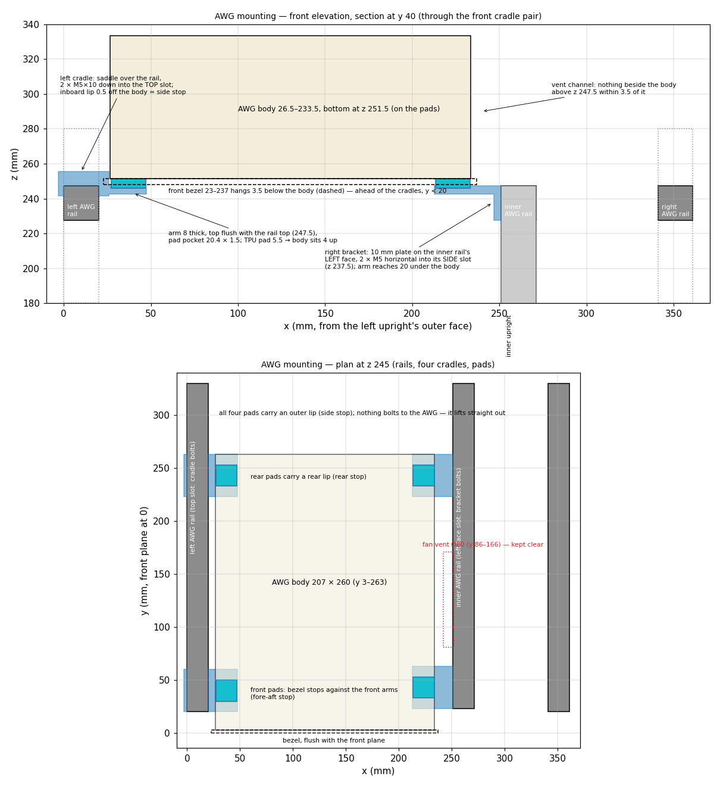

*(The sheet shows the first AWG cradles, with 8 mm arms and a 10 mm right plate; the fitted v2 cradles have 5 mm arms and a 4 mm plate with countersunk screws — the positions are the same.)*

### 7.1 PSU cradles

Each PSU cradle is a saddle over the rail with a conical cup for one foot, held by two M5 × 10 down into T-nuts in the rail's **top** slot. Push the sacrificial skin out of each cup and each counterbore first.

41. Drop 4 T-nuts into the left PSU rail's top slot and 4 into the PSU-level inner rail's top slot.
42. Set a `psu-cradle-v3` on the left PSU rail near the front and another near the rear, cups inboard, two M5 × 10 each just nipped.
43. Set `psu-cradle-right-front-v5` on the inner rail near the front and `psu-cradle-right-v4` near the rear, cups toward the left, M5s just nipped.
44. Lower the **PSU L** jig onto the left pair — its two feet into the two cups — and slide the pair until the jig's nose arm touches the front-left upright's rear face (y 20); tighten the four M5s.
45. Lower the **PSU R** jig onto the right pair the same way, nose against the front inner upright's rear face (y 23); tighten.
46. Lift the jigs out.

**Check:** the four cup centres are at y 51 and 253.5 on both sides; the two saddles on each rail are square to it. **What the record found here:** with the right cradles at their drawn reach the PSU's right feet landed on the cup rims — the PSU's feet were 155.5 apart, not the catalogue figure. The right-rear v4 and right-front v5 are at the as-built spacing, and the PSU sits very slightly skewed as a result (right front cup at x 213.25, right rear at 217.25, left pair at 61.75). If your PSU's right feet land on rims rather than in cups, that is the `REACH_*` fix in chapter 6's table.

### 7.2 AWG cradles

The left AWG cradles are saddles on the left AWG rail with a 5 mm arm reaching in, flush with the rail top, carrying a 20.4 mm square pad pocket; the right ones are a 4 mm plate on the inner AWG-level rail's **left** face, two countersunk M5 × 10 horizontally into that face's slot, with the same arm.

47. Drop 4 T-nuts into the left AWG rail's top slot and 4 into the inner AWG-level rail's left-face slot.
48. Set an `awg-cradle-left-v2` on the left AWG rail hard against the front-left upright (its front edge at y 20), two M5 × 10, tight.
49. Set an `awg-cradle-right-v2` on the inner rail's left face flush with the rail's front end (y 23), two M5 × 10 countersunk, tight.
50. Set the second left cradle loosely further back and lower the **AWG L** jig into the front cradle's pocket and the rear one's: slide the rear cradle until both bosses sit down (203 apart); tighten.
51. Set the second right cradle loosely and do the same with the **AWG R** jig (200 apart); tighten.
52. Push a PETG pad stand-in into each of the four pad pockets (the TPU pads replace them in chapter 11).

**Check:** the arm tops are flush with the rail tops (z 247.5); the right plates sit 2.5 off where the PSU's side will be; the four pockets at y 20–40 / 223–243 (left) and y 23–43 / 223–243 (right).

### 7.3 Seat the instruments

53. Lower the PSU in from the front, feet into the four cups, face against the left PSU rail.
54. Lower the AWG onto the four pads, bezel against the front arms, body 26.5 in from the left.

**Check — what "right" looks like:** both fronts 3 mm behind the front plane and in line with each other; neither rocks when pressed at a corner; the PSU's top is 3 mm under the AWG arms' underside (PSU top ≈ 242, arms 242.5 — HANDOVER §3); the AWG's bezel hangs 3.5 below its body ahead of the cradles and is the fore-aft stop; the PSU's rear fan and the AWG's two Ø80 side vents are clear. **Failures the record met:** PSU top touching the AWG arms (arms too thick — v1 was 8, v2 is 5), the right AWG plate touching the PSU's side (plate too thick — v1 10, v2 4), the PSU's right feet on the cup rims (the reach). All three are in the fitted parts; if you see one, it is your instruments differing from these.

---

## 8. Drawers

Three drawers, all on printed runners with the same idea: a rib on the runner rides in a house-shaped groove on the drawer, 0.3 of clearance, and the drawer pulls clean off the rib at full travel — that is also how it comes out. There are no stops and no lids: contents stay below the wall tops.

### 8.1 The bottom drawer

**Have ready:** `drawer-runner-300-v1` ×2 (plates 02, 03 — one file, the right one is turned end for end); `drawer-Q1-v1` … `Q4-v1` (09–12); `drawer-facia-v1` with its logo (26); `pull-insert-bottom-v2` (32); 8 M5 × 10 + 8 T-nuts; 4 M3 × 10; CA.

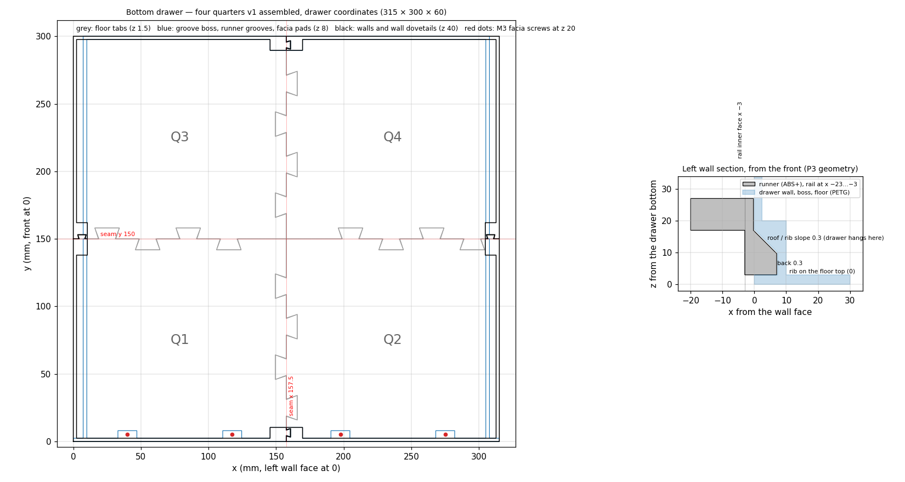

**Runners.** Each runner is an L: a leg over the base rail's top, bolted down into the rail's **top** slot through four counterbored M5, and a plate down the rail's inner face carrying the 7 mm rib. The four bolts pull the print flat — do them all up.

55. Push the sacrificial skin out of the four counterbores in each runner.
56. Drop 4 T-nuts into each base rail's top slot.
57. Set a runner on the left base rail, leg on the rail top, plate down the inner face, rib inboard, its ends at y 23 and 323 (the counterbores land at frame y 43 / 130 / 216 / 303); four M5 × 10, tighten in turn until the plate lies flat on the rail face.
58. Turn the second runner end for end and fit it to the right base rail the same way.

**Check:** both ribs level with each other and parallel; no gap between plate and rail face along the length.

**The four quarters.** Q1 is front-left, Q2 front-right, Q3 rear-left, Q4 rear-right (seen from above). Floor tabs interleave along each seam and a vertical dovetail at every wall crossing slides **down**; everything assembles vertically.

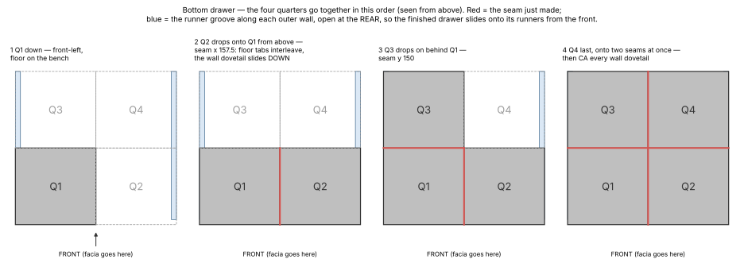

59. Trim any brim off the dovetails' flanks.
60. Put Q1 down, floor on the bench, its front wall (the one with two screw pads inside) toward you.
61. Lower Q2 onto Q1's right-hand edge from above: the floor tabs interleave on the seam and the front-wall dovetail slides down; press until the floors are flush.
62. Lower Q3 onto Q1's rear edge the same way.
63. Lower Q4 onto Q2's rear edge and Q3's right edge at once; press flush.
64. Run CA into every **wall** dovetail (the floor tabs stay dry — they are held by the walls) and leave it to set.

**Check:** the drawer measures 315 × 300 × 60; the floor is flat; the groove in the boss along each outer wall runs straight from the front wall (closed) to the rear (open).

65. Push the drawer onto the two runners from the front — the ribs enter the grooves at their open rear ends — and run it home and out a few times.

**Check — this is the friction verdict:** it slides freely by hand along the whole 300 and does not stick; the as-built pair "fit and slide well" on four bolts each. If it binds, chapter 14.

**The facia and pull.** The facia carries a notch in its top edge for the blue pull insert and four Ø2.5 blind holes in its back for the M3s; the insert has a flange that sits on the facia's back and a leg that hooks over the drawer's front wall, so a pull loads the facia, not the glue.

66. Set the pull insert into the facia's notch from behind, flange against the facia's back, and CA it (flush at the front and top).
67. Run a bead of CA along the drawer's front wall and its four screw pads, press the facia on with the iguana top-right, and drive the four M3 × 10 from inside the drawer into the facia's blind holes; the insert's leg sits inside the front wall.

**Check:** the facia is centred (315 wide on a 315 body), flush with the uprights when the drawer is home, with 1 mm to the sill panel above; the logo reads.

### 8.2 The column drawer

**Have ready:** `column-drawer-v3` (plate 13); strips `column-strip-lower-v1` (right, 260), `column-strip-lower-short-v1` (left, 140), `column-strip-upper-v1` ×2 (plates 04, 05); `column-facia-v1` (28); `pull-insert-column-v2` (32); 14 M5 × 10 + 14 T-nuts; CA.

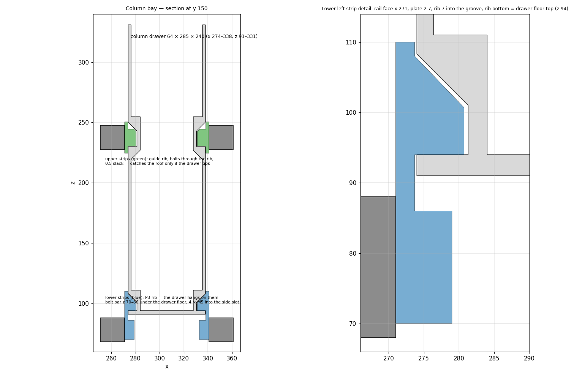

The drawer (64 wide × 285 deep × 240 tall) hangs on two **lower** strips at PSU level — the same rib-in-groove as the bottom drawer, rib bottom at z 94 — and two **upper** strips at AWG level only catch it if it tips. All strips bolt horizontally into side-face slots with counterbored M5s; the lower strips carry theirs in a bolt bar under the drawer floor.

68. Push the sacrificial skin out of every counterbore.
69. Drop T-nuts: 4 into the right PSU rail's inner-face slot, 2 into the PSU-level inner rail's right-face slot, 4 into the right AWG rail's inner-face slot, 4 into the AWG-level inner rail's right-face slot.
70. Bolt the 260 lower strip to the right PSU rail's inner face (x 341), rib toward the left, its ends at y 45 and 305 (it must start behind the front-tie bracket at y 43); four M5 × 10, tight.
71. Bolt the **short** lower strip to the PSU-level inner rail's right face, rib toward the right, centred between the two right PSU cradles' saddle lips (there is 144 clear between them); two M5 × 10, tight.
72. Bolt the two upper strips to the right AWG rail's inner face and the AWG-level inner rail's right face at y 45–305, ribs inboard; four M5 × 10 each.
73. Set the pull insert into the facia's notch from behind and CA it.
74. Press the facia onto the two Ø3.2 pegs that locate it in the drawer body's front-wall holes (x 16 and 48 from the body's left wall, 20 up) and CA it; no screws.
75. Slide the drawer in from the front, its lower grooves onto the two lower ribs.

**Check:** the drawer runs the full travel and comes out 215 (left) / 243 (right) before it pulls clean off; the facia (65 × 245) is flush with the uprights, 2 to the sill panel's right, 1 clear of the mini-slot facia; the drawer's top edge (z 331) is below the right sled beam (337) when the sled is in. **Note:** the printed v1 body had its front wall's top 29 mm cut out by hand for the insert's leg; `column-drawer-v3` has that window already.

### 8.3 The mini slot

**Have ready:** `mini-slot-body-v1` (plate 14), `mini-slot-runner-v3` (05), `mini-slot-facia-v1` (28), `pull-insert-mini-v2` (32); 3 M5 × 10 **countersunk** + 3 T-nuts; CA.

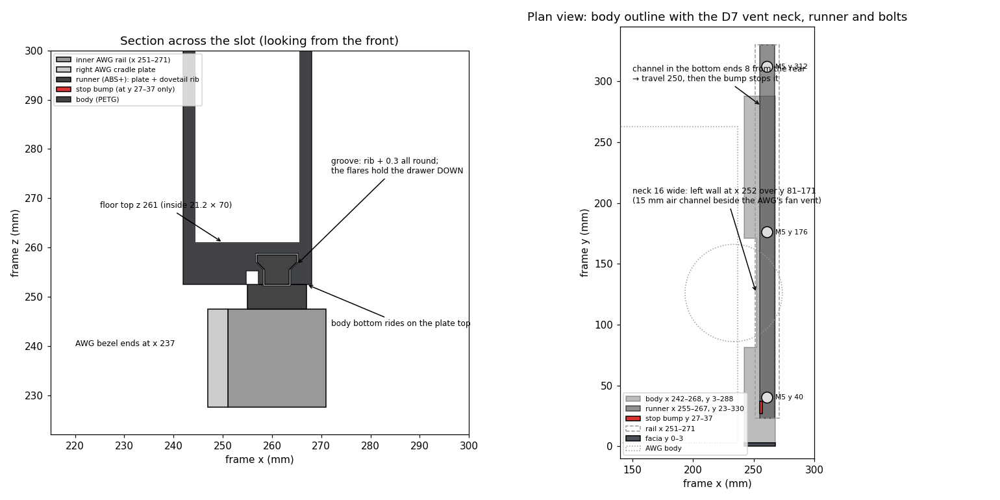

The slot (26 wide, 285 deep) rides on a 12-wide runner on the AWG-level inner rail's **top**, a dovetail rib holding it down; its left wall steps in over y 81–171 to leave a 15 mm air channel beside the AWG's right-hand fan vent. The runner's three screws are countersunk and sunk 1 mm below the plate top so the drawer passes over them.

76. Drop 3 T-nuts into the AWG-level inner rail's top slot.
77. Set the runner on the rail top, rib up, its ends at y 23 and 330 (the screws land at y 40 / 176 / 312), and drive the three countersunk M5 × 10 until each head is below the plate top.
78. CA the pull insert into the facia's notch from behind.
79. Press the facia onto the body's two Ø3.2 pegs (at the front-wall pads, x 249 / 261 in the frame, 275 up) and CA it.
80. Thread the body onto the runner from the front, groove over the rib, until the facia's back touches the sub-frame's front upright.

**Check:** the slot pulls out 250 and stops on the runner's bump; the facia (26 × 88) is flush with the uprights; the right wall stands 15 clear of the AWG's vent over y 81–171. To remove it: drawer fully out, the three M5s out (they are exposed), drawer and runner forward together. **Thermal check (do it once the skin is on):** all three instruments on for an hour, slot in — the AWG's fan should sound as it does on the open bench and the slot's right wall be at most slightly warm.

---

## 9. The sled and the box

**Have ready:** the beam halves `sled-beam-left-front-v2`, `-right-front-v2`, `-left-rear-v1`, `-right-rear-v1` (plate 01); `sled-front-bar-v3` (29); `sled-cross-bar-front-v2`, `-rear-v2` (07); `sled-front-rest-v2-gap3.0` ×2 (14 — see step 90 about the gap); `sled-splice-v2` ×2, `cable-channel-v1` (08); `sled-bar-pull-liner-v1` (32); `rear-box-left-v1`, `-right-v1` (30, 31); `box-brace-v1` ×2 (33); 2 M5 × 10 countersunk + 2 T-nuts; CA; PTFE spray.

The scope rides on two beams, each carried at the rear by the T-foot already in its scope rail and at the front by a rest on the rail top. The feet, beams and cross bars were all glued because a dry tab's 0.15 of play is 0.8 mm at the scope's stands: **CA every tab and tongue.**

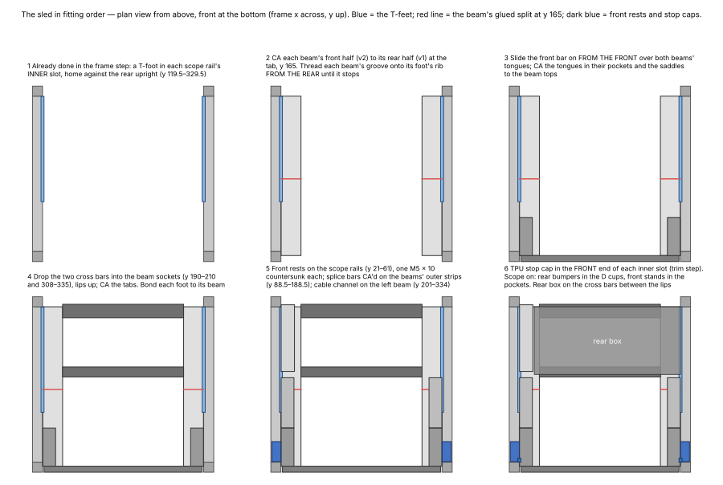

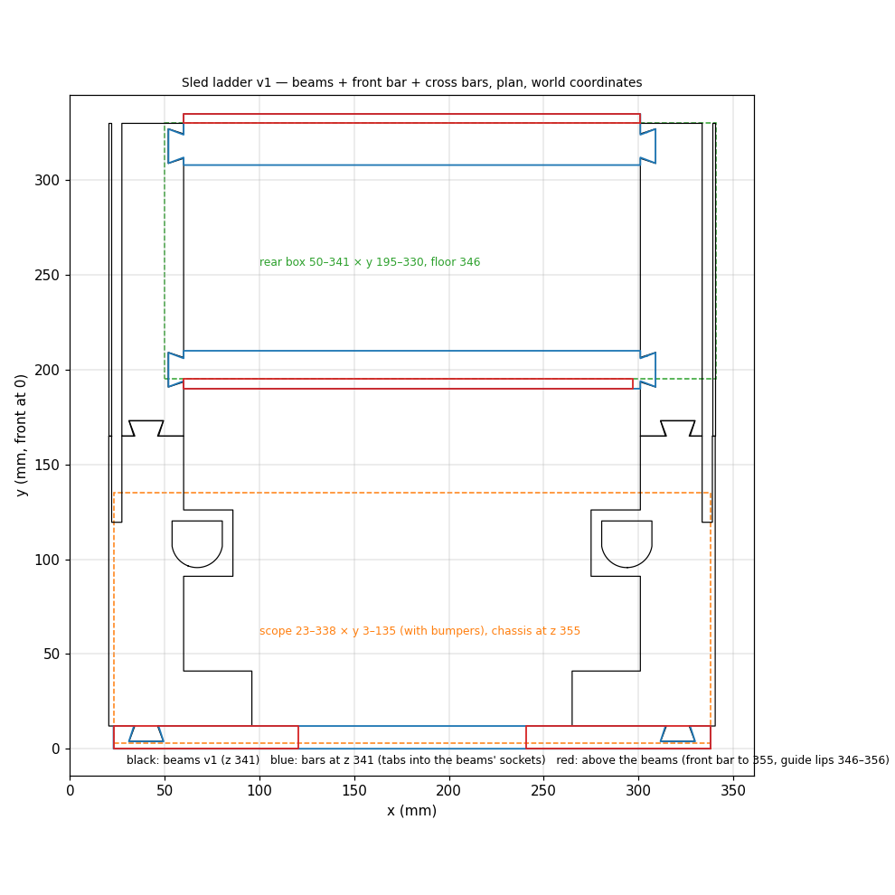

### 9.1 Beams onto the feet

81. Trim any brim off the beam halves' tab flanks and tongues.
82. CA each beam's front half to its rear half at the trapezoid tab (the split at y 165): left-front to left-rear, right-front to right-rear. The front halves are the ones with the D-shaped cup and the open-fronted stand pocket.
83. Spray PTFE dry lube along each scope rail's inner slot and the foot's flanks.
84. From the **rear** of the frame, thread the left beam's underside groove onto the left foot's rib and push the beam forward until the groove's closed end stops on the foot (the foot then runs y 119.5–329.5 under the beam); the beam passes inboard of the rear upright.
85. Do the same with the right beam. Check both beams' front ends are at y 12, 8 mm behind the front plane, and that they can slide together with their feet.

### 9.2 The front bar and cross bars

86. From the front, slide the front bar onto the beams: each beam's 68 mm tongue enters a closed pocket in the bar's rear face. Push until the bar's rear face meets the beams' front faces (bar at y 0–12).
87. Run CA into each pocket from behind and under each 25.5 × 76 saddle where it lies on the beam top; press and hold. The saddles' screw holes are not used.
88. Drop the front cross bar into the beams' sockets at y 190–210 and the rear one at y 308–335, guide lips **up**, the chamfered lip end to the right; CA every tab.
89. Pull the sled fully forward and push it home a few times, then run CA along each foot's rib where it meets the beam's groove (from the rear) so foot and beam are one piece.

**Check:** the sled slides the length of the rails and back by hand, stays level, and the beams cannot roll inward when you press down on them 45 mm inboard of a foot (that roll is what the bar and bars are there to stop). The beams' undersides are at 337, 1 mm above the AWG's bezel at 336 — nothing can ever go under them.

### 9.3 Front rests, splices, channel

The beam's front 108 mm hangs past the foot and bent under the scope; the **front rest** carries it on the rail top, and the **splice bars** stiffen the span over the glued joint.

90. Measure, at the front, the gap between each scope rail's inner face and the beam's outer face. The rests come in six sizes (0.5 to 3.0 in 0.5 steps, stamped on the part); the as-built frame measured 3.0 on both rails and `sled-front-rest-v2-gap3.0` is the one in the .3mf. If yours is smaller, export the matching one: `python src/parts/sled_front_rest.py`.
91. Drop a T-nut into each scope rail's **top** slot near the front.
92. Set a rest on each rail top at y 21–61, plate on the rail, its lip standing up beside the rail's inner edge against the beam's outer wall; the same part turned 180° serves the right rail. One countersunk M5 × 10 each, just nipped.
93. Push the sled home, pull it out to the front, home again — the lip must ride under the beam's wall the whole way — then tighten both rests.
94. CA a splice bar along each beam's **outer** strip from y 88.5 (just behind the front bar's saddle) to 188.5, over the joint; on the left beam its Ø4.3 hole goes over the beam's Ø4 peg at (33, 150).
95. CA the cable channel onto the left beam's top at y 201–334, its floor hole over the beam's rear peg at (33, 290), outer wall flush with the beam's outer face, the chamfered corners at the front.
96. CA the blue liner into the front bar's 120 × 6 pull notch.

**Check:** with a 3 kg weight on the beams' front ends (or the scope on, chapter 9.5) the front does not sag visibly, pulled out or home; the right splice stands 7.5 above the beam — remember it when the box comes out.

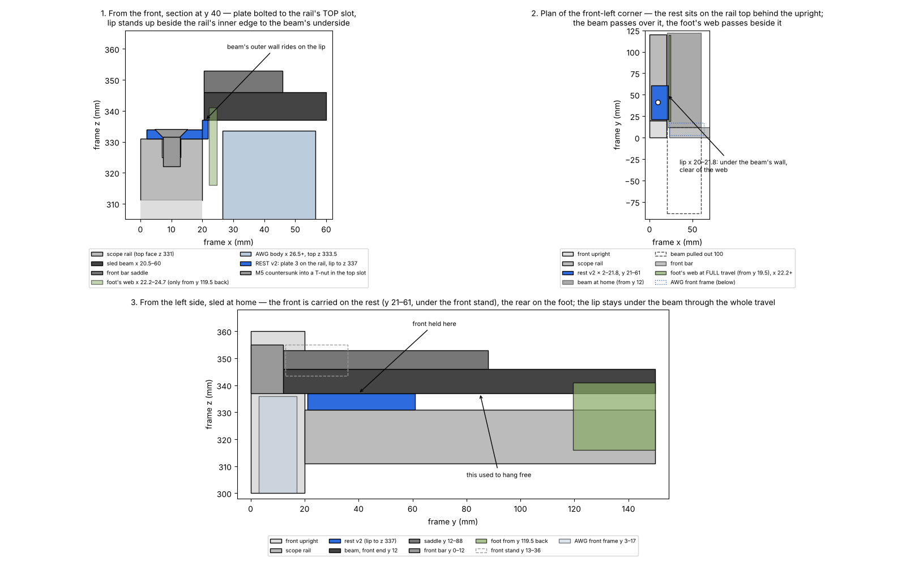

### 9.4 The rear box

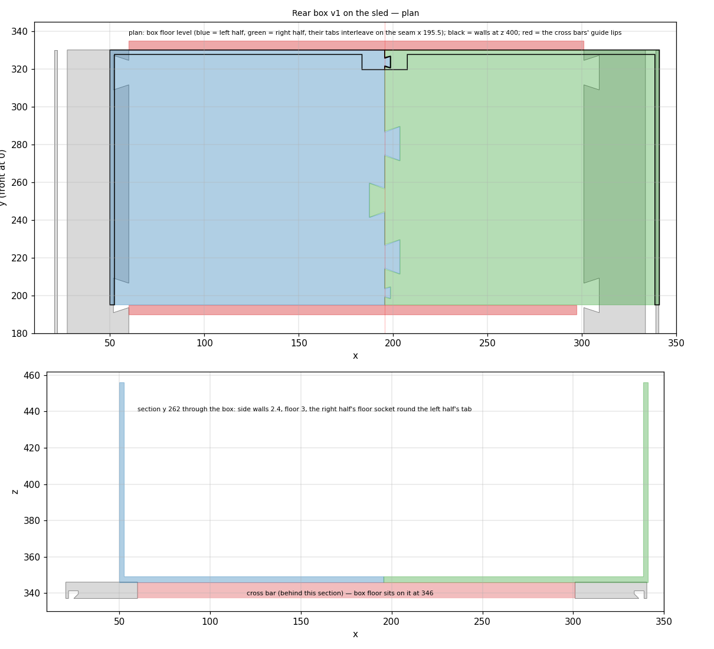

97. Trim any brim off the two halves' dovetails.
98. Put the left half down, floor on the bench, and lower the right half onto its seam at x 195.5 from above — three floor tabs interleave and the dovetails at the rear wall and the front lip slide down; press flush.
99. Run CA along the seam inside and out.
100. CA a corner brace **into each front corner**: one leg on the side wall's inner face, one on the lip's rear face, standing on the floor — the right wall cracked at the lip on the as-built box, and the braces are now fitted as a matter of course.
101. Set the box on the sled's cross bars, between their guide lips (2 mm of play fore-aft), 20 mm lip toward the front.

**Check:** the box (291 × 135 × 110) sits at z 346–456 with 2 mm fore-aft play and slides to the right between the lips.

### 9.5 Scope on, and the access sequence

102. Lower the scope onto the beams from the front: its two rear D-shaped bumpers into the two cups (flats to the rear), its two folded front stands into the open-fronted pockets.
103. Pull the sled forward to the stop caps (chapter 11 fits them — until then, pull it out 92) and push it home.

**Check:** the scope's bezel is 3 mm behind the front plane at home; it stays level pulled out; nothing under the beams touches the AWG. **The access sequence** (confirmed on the as-built tower): sled out to the stops → door down (chapter 10) → the box lifted **7.5 mm over the right splice** and drawn out to the right → reverse. Until the skin and door exist, check only that the box exits to the right into clear air.

---

## 10. The skin

**Have ready:** the side tiles (plates 15–21: `tile-band1-LF/LR/R-v2`, `tile-band2-LF/LR-v2` and `-RF/RR-v1`, `tile-band3-LF/LR/RF/RR-v2`), `tile-band4-LF-v1`, `-LR-v1` (22, 23); the door set — `door-v3` (24), `rear-tile-v2` (20), `magnet-bracket-front-v2`, `magnet-tab-rear-v2`, `hinge-door-v2` ×2, `hinge-frame-v2` ×2 (08), `hinge-pins-v1` (14); the top tiles `top-tile-FL/FR/RL/RR-v1` and `upright-cap-v1` ×4 (25, 32); 4 magnets; 2 M5 × 12, 4 M5 × 10 + 6 T-nuts, 4 M5 × 10 for the caps; CA. **Measure first (chapter 6):** the tiles must be the ones for your rail gaps.

### 10.1 Side tiles

A tile is a 3 mm hex-perforated sheet with spring fingers on its back; each finger's barb hooks under the lip of a rail's **outer** slot. Tiles run from one rail's slot centreline to the next and cover the rails; two tiles that share a slot have their fingers interleaved, so **the finger positions tell you which tile goes where** — the skin sheet shows every tile and every finger, both sides, seen from outside.

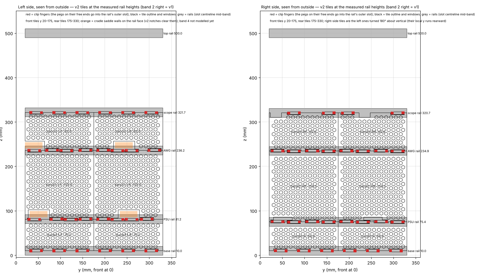

104. Lay the tiles out by side and band: left band 1 front/rear (LF/LR), band 2 LF/LR, band 3 LF/LR; right band 1 (two of the same `tile-band1-R`), band 2 RF/RR (the v1 pair), band 3 RF/RR. The left band-2 and band-3 tiles have notches, open to their bottom edges, that fit round the PSU and AWG cradles' saddle walls; band 3 right has windows for the hinge leaves. A right-side tile goes on with its local "front" toward the rear — it is the left tile turned 180° about vertical.
105. Start with left band 1 front (y 20–175): offer the tile to the base and PSU rails, fingers to the slots, and press each finger home with a thumb — it snaps in. Then band 1 rear.
106. Band 2 left, front then rear, bottom fingers into the PSU rail's slot between band 1's top fingers, notches round the PSU saddles.
107. Band 3 left, notches round the AWG saddles.
108. The right side the same way, bands 1 to 3 — but **not before the hinge frame leaves are on** (10.2, step 111): the band-3 right tiles' windows fit round them.

**Check:** every tile lies flat on the rails with no rock; the hex pattern lines up across the seams; the saddle walls sit inside their notches with air round them. **To take a tile off:** slide a thin blade (a knife or a 1 mm steel rule) against a finger's free end where it stands in the slot and lever the barb off the lip, one finger at a time, then angle the tile off; it comes off only by angling. **If a tile's top fingers stop short of the rail's slot, or it will not go on, the band height is wrong for your frame — chapter 14.**

### 10.2 Band 4 right: the door set

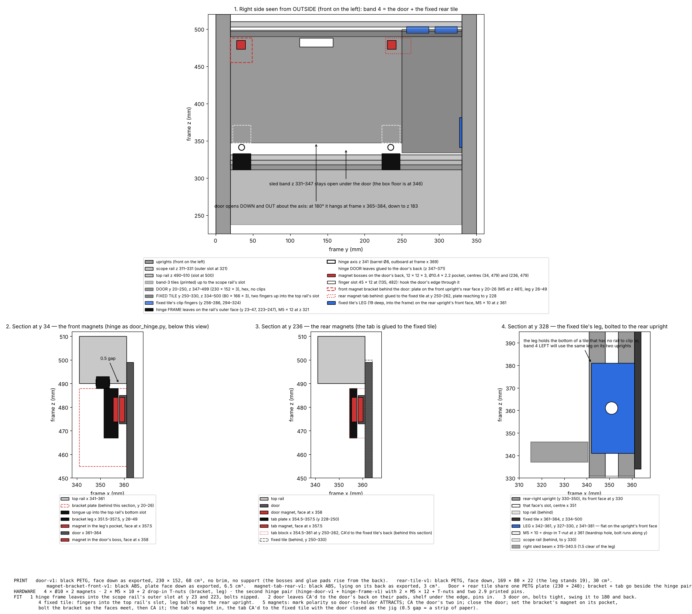

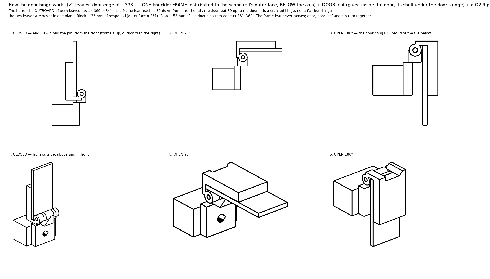

The door (230 × 161 × 3) hangs on two printed hinges below its bottom edge and opens **down and out**, past 180°; two magnet pairs hold it at the top. The hinge is cranked: the **frame leaf** bolts to the right scope rail's outer face and reaches down to the axis, the **door leaf** is glued inside the door and reaches up to it; a Ø2.9 printed pin joins them and is glued into the **door** leaf only. The fixed rear tile (80 × 166) fills y 250–330 beside the door, hangs from the top rail by its fingers and has a bolted leg on the rear upright. Fitting order, from the sheet:

109. Drop 2 T-nuts into the right scope rail's **outer** slot and push them to y 23–47 and y 223–247.
110. Bolt the two **hinge frame leaves** to the right scope rail's outer face at y 23–47 and 223–247, barrels outboard and **below** the axis, one M5 × 12 each at z 321 — just nipped.
111. Fit the right band-3 tiles (step 108): their windows go round the two frame leaves. Then tighten the leaves.
112. CA the two **door leaves** to the pads on the door's back, their shelves under the door's bottom edge, barrels in line with the frame leaves at y 23–47 and 223–247 (dry-fit the door against the frame leaves first to be sure).
113. Push a pin through each knuckle — door leaf segment, frame leaf's middle segment, door leaf segment — and CA it **at both ends into the door leaf's segments only**; the frame leaf's segment must turn free. The ~3 mm V at each joint line is the printed cone on a segment end, not a gap.
114. Hang the door: frame leaves through the door leaves' gaps, pins in. Swing it from closed through 90° to 180° — it should fold flat past 180 and hang about 10 proud of the band-3 tile below.
115. Drop 2 T-nuts into the rear-right upright's **front-face** slot and into the front-right upright's **rear-face** slot.
116. Offer the **fixed rear tile** at y 250–330: two fingers up into the top rail's outer slot, its leg flat on the rear-right upright's front face; one M5 × 10 through the leg into the T-nut at z 361. The leg adjusts in z — set the tile's bottom edge at 334, 3 above the scope rail.
117. **Magnets, polarity first:** mark the four magnets so each door magnet **attracts** its holder's magnet. CA the door's two magnets into the bosses on its back at (y 34, z 479) and (y 236, z 479).
118. Close the door. Set the **front magnet bracket** (an L on the front-right upright's rear face, tongue up into the top rail's bottom slot) with its magnet in its pocket, bring it to the door's front boss until the faces are 0.5 apart (a strip of paper between them), bolt it (M5 × 10 at z 461), then CA its magnet.
119. With the door still closed as the jig, put the **rear magnet tab**'s magnet in its pocket, CA the tab to the fixed tile's back at y 250–262 with its plate reaching forward behind the door's rear boss, the paper strip between the magnets.

**Check:** the door swings past 180 without the bottom touching the rail, the right front rest or the foot (its edge is at 338, 7 above the rail); it closes onto both magnets and holds; the 45 × 12 finger slot at the top (y 135, z 482) is where you hook it open; with the door open, the box exits to the right over the right splice without touching the door or its leaves.

### 10.3 Band 4 left

Band 4 left (z 335–500) has no rail under it — the sled band is open — so each of its two tiles hangs from the top rail by three fingers and stands on a **leg** bolted to the upright's face, the same leg as the fixed rear tile.

120. Drop a T-nut into the front-left upright's **rear-face** slot and one into the rear-left upright's **front-face** slot.
121. Offer `tile-band4-LF-v1` at y 20–175: three fingers up into the top rail's outer slot, its leg flat on the front-left upright's rear face; M5 × 10 into the T-nut at z 361, the tile's bottom 3 above the scope rail.
122. `tile-band4-LR-v1` at y 175–330 the same way, leg on the rear-left upright's front face; the two tiles meet at y 175 on a plain edge.

**Check:** the left sled beam and the cable channel clear the two legs (the legs stop at x 19, the beam starts at 20.5); the LED strip's position on the rear-left upright's inner face (z 20 up) is not covered by the rear leg.

### 10.4 The top panel

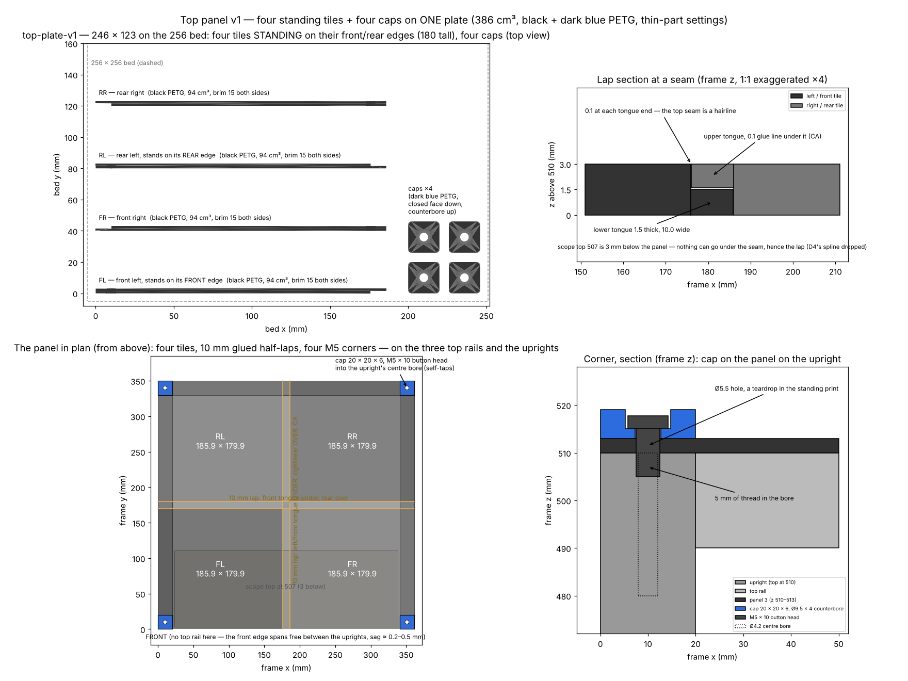

Four 185.5 × 180 × 3 tiles meet on 10 mm half-laps — the left and front tongues go **under**, the right and rear tongues **over** — and are glued on the frame into one 362 × 350 sheet that lies on the four uprights' tops and the three top rails. A dark blue cap sits on each corner with an M5 × 10 button head through the panel into the upright's centre bore (an M5 self-taps the bore; 5 mm of thread).

123. Trim the brim off every tile's bed edge (the long edge it stood on).
124. Set **FL** (front left) on the frame's front-left corner, its tongues toward the seams; screw its cap down through the corner hole into the upright's bore.
125. Run CA along FL's two lower tongues (the right one and the rear one).
126. Set **FR** on, its left tongue over FL's; screw its cap.
127. CA FR's rear tongue.
128. Set **RL** on, its front tongue over FL's; screw its cap.
129. CA RL's right tongue.
130. Set **RR** on, over FR's and RL's tongues; screw its cap.

**Check:** the seams at x 180.5 and y 175 are hairlines; the panel is flat (a straightedge across it); 3 mm from the scope's top (507) to the panel (510) with the sled home and pulled out; the caps stand 6 proud. The panel lifts off as one sheet with the four screws out.

---

## 11. Trim

**Have ready:** the TPU plate (34): `frame-foot-v1` ×4, `awg-pad-left-v1` ×2, `awg-pad-right-v1` ×2, `sled-stop-cap-v1` ×2, `slot-cover-240-v1` ×6; `strip-bracket-upper-v2`, `strip-bracket-lower-v5`, `sill-block-left-v10`, `sill-block-right-v4` (33); `sill-panel-v3` with `sill-panel-window-v4` (27); the power strip; 4 M5 × 10 + 4 T-nuts; the button and its nut (if lighting); CA; scissors.

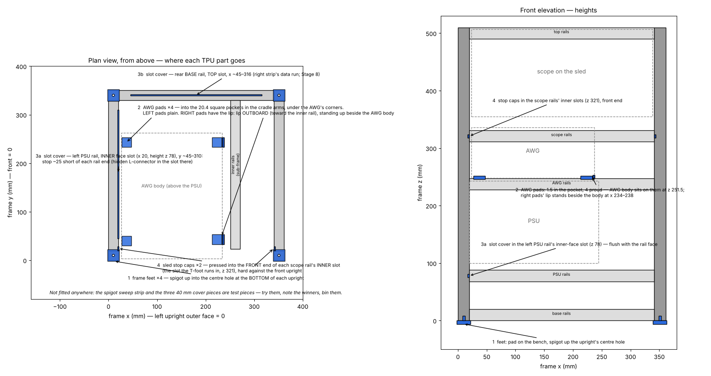

*(On this overview the rear base rail's cover is drawn in the rail's top slot; it was moved to the **rear** slot — the detail sheets below and HANDOVER §7 are right.)*

### 11.1 TPU: feet, pads, stop caps

131. Tilt the frame and push a frame foot's Ø4.6 spigot into the centre bore at the **bottom** of each upright, with a drop of CA on the spigot; pad down. The frame now stands 6 above the bench.
132. Pull the four PETG pad stand-ins out of the AWG cradles (lift the AWG). Push a plain **left** pad into each left cradle's pocket, pad down. Push a **right** pad into each right cradle's pocket with its tail toward the inner rail and its lip standing up **outboard**, beside where the AWG's right edge will be; AWG back on.
133. Press a **stop cap** (8 mm of cover profile) into the **front** end of each scope rail's inner slot — the slot the sled foot runs in — from inside the frame, hard against the front upright. The foot's front end lands on it at full pull; travel is 92.

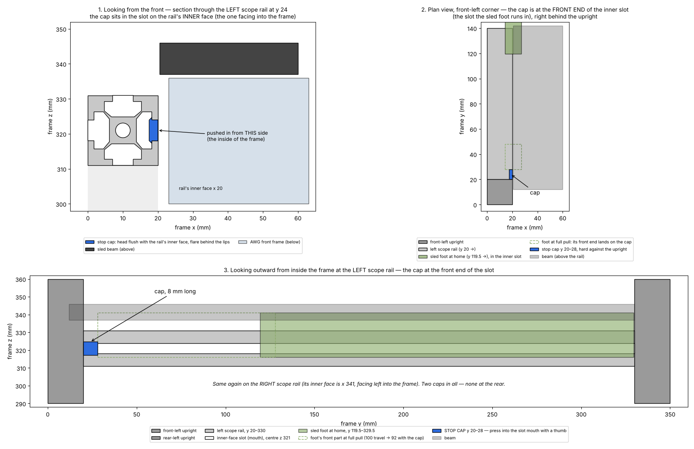

**Check:** the frame sits level on its feet with no rock; the AWG sits on its four pads, 4 proud of the arms, and cannot shift right (the right pads' lips stop it); the sled pulls out 92 and stops, and the caps stay in by thumb pressure alone.

### 11.2 Slot covers

The covers hide the lighting wires (chapter 12); if you are not fitting lighting, skip them. Cut with scissors.

134. Cover **A**: one 240 strip plus a 20 off-cut into the **left PSU rail's inner-face slot**, from y 45 to 305 — stopping 25 short of each rail end, where the hidden connectors are. Push the head in along its length by thumb.
135. Cover **B1**: 65 into the **rear base rail's rear slot** at x 25–90; **B2**: 186 at x 150–336 (the board enclosure sits between them at x 90–150).

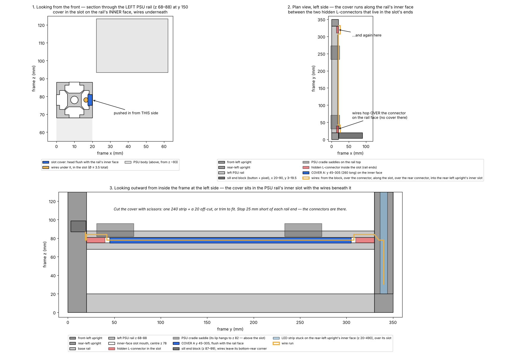
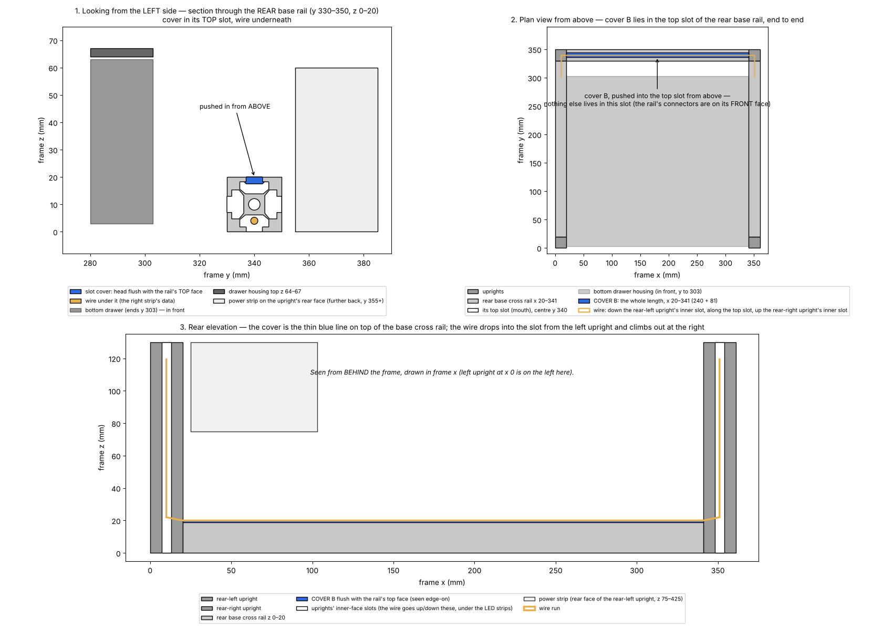

**Check:** a fingernail cannot lift a cover; the wires run under it with 3.65 of room (the USB lead must be ≤ 3.5 outside diameter).

### 11.3 The power strip

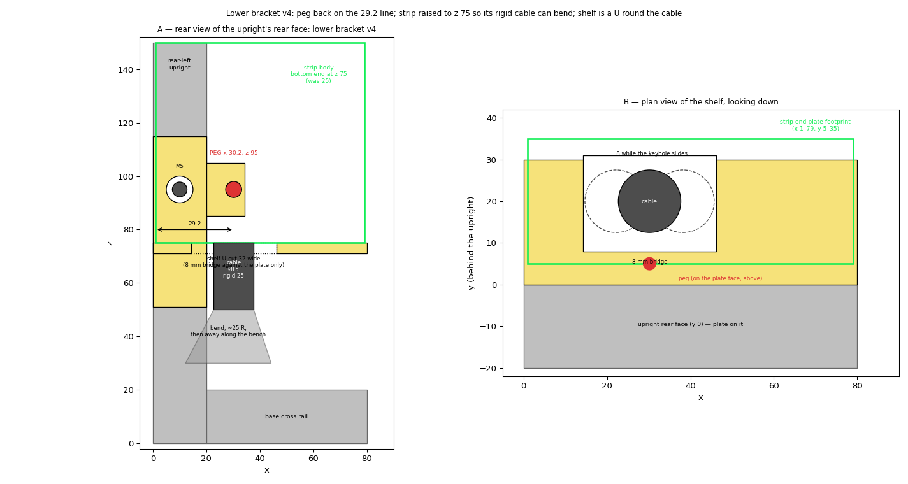

The strip hangs **vertically** on the rear face of the rear-left upright, sockets toward the wall, cable end **down**, on two brackets whose pegs enter its keyholes; the lower bracket's U-shaped shelf takes the weight round the Ø15 mains cable. The fitted brackets had their bolt hole drilled by hand (Ø5.5 with a Ø10 × 2.5 counterbore); `strip-bracket-upper-v2` and `lower-v5` have it printed.

136. Drop 2 T-nuts into the rear-left upright's **rear-face** slot.
137. Bolt the **lower** bracket with its bolt at z 95, shelf down, the shelf's U toward the strip's cable; M5 × 10, tight.
138. Bolt the **upper** bracket at z 344.5; M5 × 10, tight.
139. Hang the strip: both keyholes over the pegs, slide down until the pegs seat and the bottom end rests on the shelf with the cable through the U. The body sits at z 75–425.
140. Plug three 0.5 m IEC leads into it and run them up the rear-left corner to the three instruments.

**Check:** the strip hangs solidly and does not swing; its USB port (at the top end) is reachable for the lighting's pigtail.

### 11.4 The sill panel

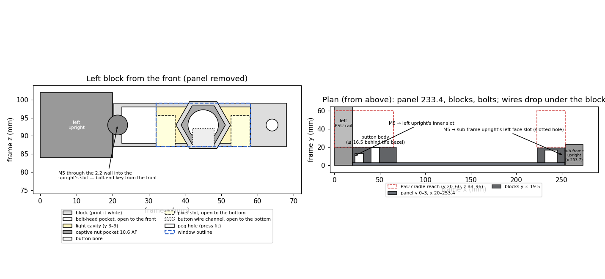

A dark grey strip (233.4 × 12 × 3) fills the band between the bottom drawer's facia and the PSU, from the left upright to the sub-frame's upright, with a clear window round the lighting button at x 45. It presses onto Ø3.2 pegs in two blocks — press fit, no glue, so it pulls off for rewiring. Each block takes one M5 driven **along** it through a key hole with a 3 mm ball-end key: the left block from its **right** end, the right block from its **left** end, under the PSU, before the panel goes on. If you are not fitting lighting, leave the button, pixels and wiring out — the panel is still the trim.

141. Drop a T-nut into the left upright's inner-face slot and one into the sub-frame upright's left-face slot, both at z 93.
142. Hold the **left block** (white) against the left upright at z 87–99, y 3–19.5, its button bore to the front, with an M5 × 10 sitting in the round pocket at its left end; put the 3 mm ball-end key in through the key hole from the block's **right** end and drive the bolt into the T-nut.
143. Hold the **right block** against the sub-frame upright's left face, M5 × 10 in its head pocket (open to the front), the key in through the slot from its **left** end; drive it.
144. **If fitting the lighting:** solder the button's four wires first — LED + red, LED − and switch pin 2 linked together black, switch pin 1 yellow, about 650 mm long to reach the board — and heat-shrink the joins. Drop the 10 mm AF nut into the left block's captive hex pocket behind the window position.
145. Press the **panel** onto the blocks' pegs with its window at the left end over the button bore; the panel's bottom edge sits 1 above the facia, its top 1 under the PSU, its right end 0.3 from the sub-frame upright.
146. **If fitting the lighting:** offer the button to the window from the front with its four wires hanging down through the 3.2 notch in the window's bottom edge; push it in — the wires trail rearward along the open-bottom slit under the button bore — and when its thread meets the captive nut, screw it home. Then push the two pre-wired 5 mm pixels into the block **from the rear**, one into each Ø5.7 bore, until their flanges seat; their wires go into the clip rails on the block's back face and drop down with the button's wires at x 34–58.

**Check:** the panel sits flat with no gap to the facia or the PSU; the button clicks; from the front the wire notch shows as a 3.2 × 1 nick in the clear window below the bezel.

### 11.5 Leads and caps

147. Lay the scope's mains, LAN and USB leads rearward in the cable channel on the left beam, out of its open rear end, and leave a loop behind the frame that takes the 92 travel: pull the sled out and check nothing goes taut.
148. Run the AWG's and PSU's LAN and USB leads down the rear-right corner (loose — no clips were built).
149. The four upright caps are already on (10.4).

---

## 12. Lighting (optional)

Two WS2812B strips of 15 LEDs on the rear uprights' inner faces and two 5 mm pixels in the sill's left block, driven from a small board in an enclosure on the rear base rail, powered from the strip's USB port, switched by the sill button. The as-built tower runs **SiglentGlow** (the author's firmware for the XIAO ESP32-S3) — **any WS2812 controller works**: WLED on a D1 mini or an ESP32 drives the same two buses and the same button, with the pin numbers below swapped for its own.

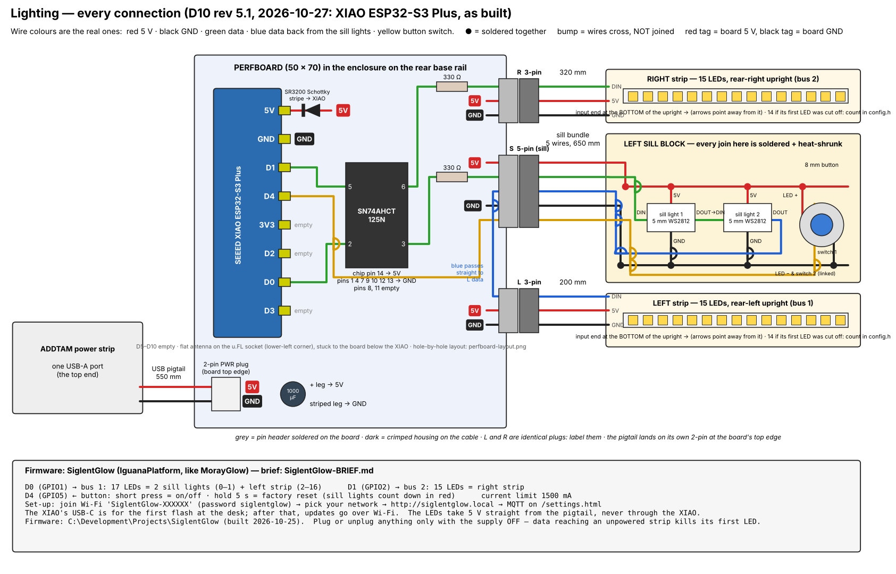

### 12.1 The board

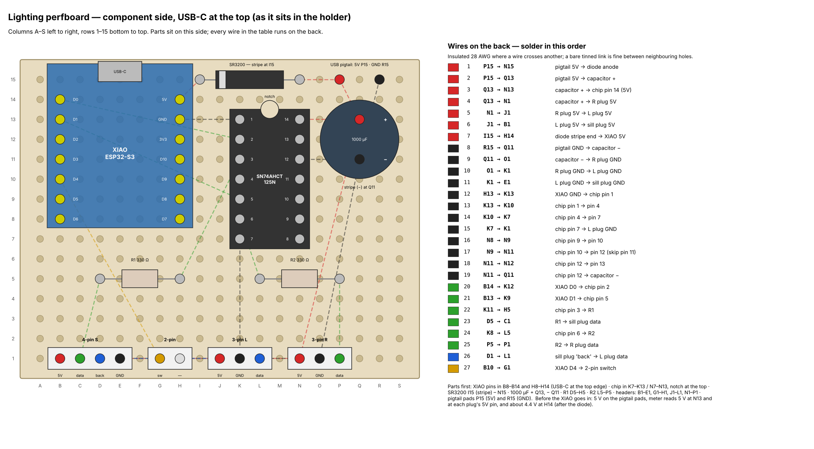

Build it exactly as the sheet shows: parts on the front (component side, USB-C at the top), every wire on the back, soldered in the numbered order. Wire colours: red 5 V, black GND, green data, blue data back from the sill pixels, yellow the button switch.

150. Fit the parts: the XIAO's pin rows (or female headers for it), the SN74AHCT125N with its notch at the top, the SR3200 with its stripe toward the XIAO, the 1000 µF (stripe = −), the two 330 Ω, and the four pin headers along the bottom and top edges: **S** 5-pin (sill), **L** 3-pin, **R** 3-pin, **PWR** 2-pin.
151. Solder the 27 back-side wires in the order on the sheet (red first, then black, green, blue, yellow).
152. **Before the XIAO goes in:** put 5 V on the PWR header; the meter should read 5 V at the capacitor's + and at each plug's 5 V pin, and about 4.4 V at the XIAO's 5 V pin position (after the diode). Nothing warm.
153. Solder or seat the XIAO. Stick its Wi-Fi antenna below it on the board, lead to the u.FL socket at the XIAO's lower-left corner.
154. Flash SiglentGlow (or your firmware) over the XIAO's USB-C at the desk; after that, updates go over Wi-Fi.

### 12.2 The cables

155. Crimp four plugs: **PWR** 2-pin on the USB pigtail (550 mm: red to 5 V, braid/black to GND); **S** 5-pin on a five-wire bundle 650 long (red 5 V, green data to the pixels, blue data back, black GND, yellow switch); **L** 3-pin on a 200 lead (5 V, GND, data) and **R** 3-pin on a 320 lead. L and R are identical plugs — label them.
156. Each strip: solder the 3-pin lead to the strip's **input** end (the arrows on the strip point away from it).
157. The sill end of the 5-pin bundle: the two 5 mm pixels in a chain — 5 V and GND to both; green data to pixel 1's **DIN**, pixel 1's **DOUT** to pixel 2's **DIN**, pixel 2's **DOUT** back down the blue wire (it becomes the left strip's data at the board) — and the button: LED + to 5 V, LED − and switch pin 2 to GND, switch pin 1 to the yellow wire. The WS2812D-F5's legs run **DOUT, VDD, GND, DIN** — the reverse of an APA106. Heat-shrink every join.

### 12.3 The enclosure

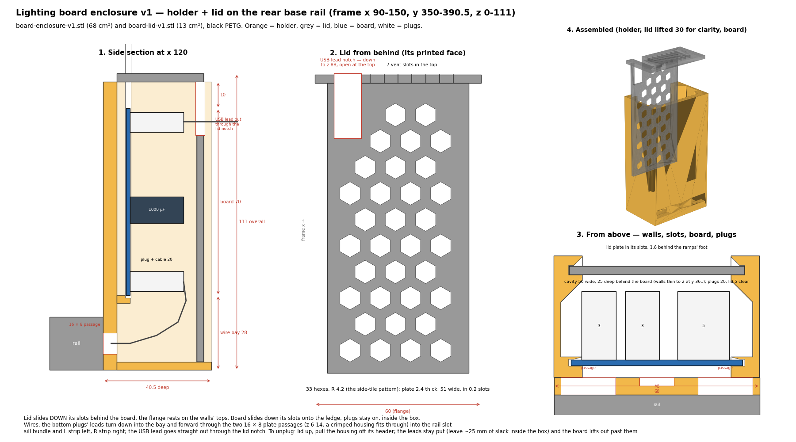

158. Drop a T-nut into the rear base rail's **rear** slot and bolt `board-enclosure-v1` to the rail's rear face at x 90–150 (one M5 × 10 at x 120, z 10), between covers B1 and B2.
159. Slide the board down the enclosure's side slots onto its ledge at z 28, components rearward, plugs along its bottom edge over the wire bay.
160. The leads leave through the two 16 × 8 passages in the plate into the rail slot — the sill bundle and the L lead through the **left** passage, the R lead through the **right**; the USB lead comes straight out through the notch at the top of the lid. Leave about 25 mm of slack inside.
161. Slide `board-lid-v1` down its slots behind the board; its flange closes the top.

### 12.4 The runs

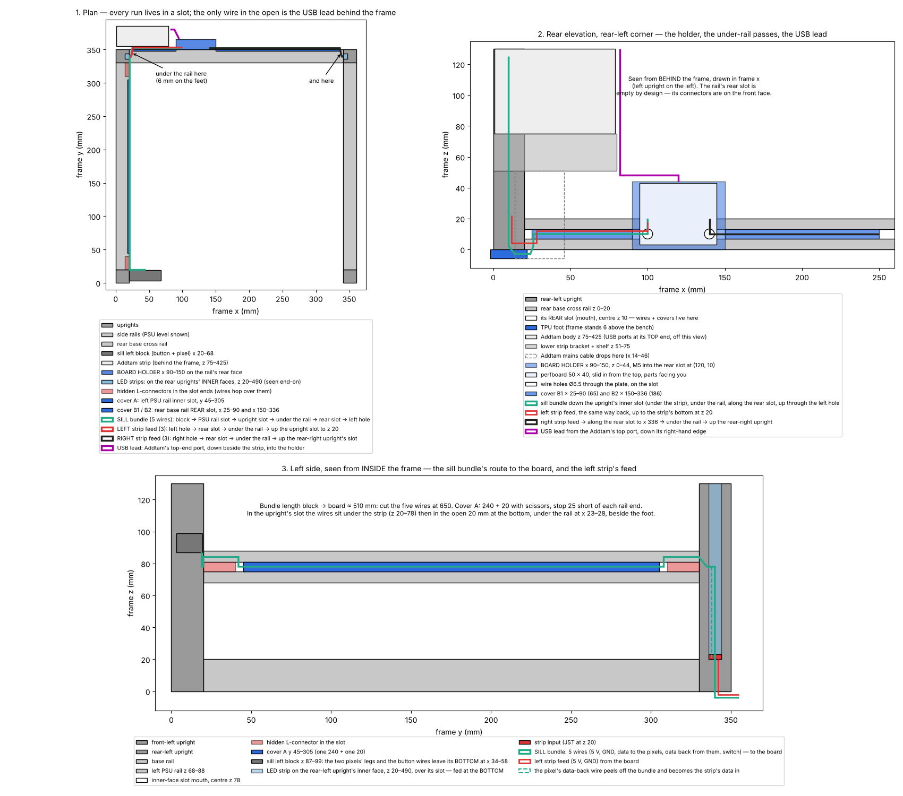

Every wire but the USB lead lives in a slot, under a cover (11.2). Fit the covers after the wires.

162. Stick the **left strip** to the rear-left upright's inner face from z 20 upward, input at the bottom; bend the top end under the top rail. The **right strip** the same on the rear-right upright.
163. The **sill bundle** (5-pin): from the left block's bottom at x 34–58, down into the left PSU rail's inner-face slot (cover A), along it to the rear, hopping over the hidden connector on the rail's face at each end, down the rear-left upright's inner slot under the strip, under the rail at x 23–28 (6 mm clear on the feet), along the rear base rail's rear slot (cover B1) and through the enclosure's left passage to the **S** header.
164. The **left strip feed** (3-pin): the same way back from the **L** header — left passage, rear slot, under the rail, up the upright's slot to the strip's input at z 20.
165. The **right strip feed** (3-pin): from the **R** header through the right passage, along the rear slot to x 336 (cover B2), under the rail at x 333–338, up the rear-right upright's inner slot to that strip's input.
166. The **USB pigtail**: from the power strip's top-end port down beside the strip, in the open, through the lid's notch to the **PWR** header.

### 12.5 First power-up

**Plug or unplug anything only with the supply off** — data reaching an unpowered strip kills its first LED.

167. All four plugs on, lid down, then the USB into the power strip's port.
168. On a phone, join the Wi-Fi network `SiglentGlow-XXXXXX` (password `siglentglow`), pick your home network, then open `http://siglentglow.local`. MQTT / Home Assistant settings are on `/settings.html`.
169. Short-press the sill button: everything on; again: off. Hold it 5 s: factory reset (the sill pixels count down in red).

**Pins, for your own firmware:** D0 (GPIO1) = bus 1, 17 LEDs: sill pixel 1 → sill pixel 2 → the left strip; D1 (GPIO2) = bus 2, 15 LEDs: the right strip; D4 (GPIO5) = button to GND. Current limit 1500 mA. The LEDs take 5 V straight from the pigtail, never through the XIAO.

**Check:** both strips light along their whole length and the two sill pixels light the window evenly past the button's nut; the button toggles; nothing on the board is warm after ten minutes.

---

## 13. Checks before you call it done

The "done when" lines from the build log, as a checklist.

- [ ] **Frame:** diagonals equal within 1 mm; 321 clear between the uprights at the front and the rear; 510 overall; no wobble pushed at a top corner; stands level on its four feet.
- [ ] **Cradles:** PSU and AWG sit level, 3 mm behind the front plane, screens' left edges in line, no rock at any corner; PSU fan and AWG side vents clear; 3 mm between the PSU's top and the AWG arms.
- [ ] **Drawers:** all three run their full travel; the bottom and column drawers pull clean off their ribs at full travel and go back; the mini slot stops at 250 and unbolts with its runner; all three fronts flush with the uprights; the logo reads; the thermal check passed (AWG fan normal after an hour, mini-slot wall at most slightly warm).
- [ ] **Sled:** the scope rides level, 92 travel to the stop caps, no visible sag pulled out, stops hold, the beams clear the AWG along the whole travel.
- [ ] **Box:** the full access sequence works — sled out, door open, box lifted over the right splice and out to the right, and back; the meters fit.
- [ ] **Skin:** every tile snapped in and flat; the door swings past 180 and catches on both magnets; the sled band is open; nothing fouls the sled or the box's exit; the top panel is flat, 3 mm above the scope.
- [ ] **Trim:** the strip hangs solid on its brackets; three IEC leads routed up the rear-left corner; LAN/USB down the rear-right; the scope's cable loop takes the travel; the sill panel presses on and off; covers hold by thumb.
- [ ] **Lighting (if fitted):** both strips and both sill pixels light; the button toggles; the web page answers at `siglentglow.local`.

---

## 14. If something does not fit

The record's own fixes, as symptom → cause → what to do.

| Symptom | What it was | What to do |
|---|---|---|
| A side tile's top fingers stop level with the bottom of the rail's slot instead of inside it, or the tile will not go on at all | The rails are not at the spacer heights — on the as-built frame up to 6 mm off, and different per side | Caliper the rail gap, face to face, front and rear (chapter 6); put the readings in `side_tile.GAPS`; `python src/parts/side_tile.py` and reprint that band |
| A left band-2 or band-3 tile hits something behind it near a cradle | The cradle saddles stand 10 above the rail top; the first tiles had windows cut for 6 mm lips only | The v2 tiles have notches open to the bottom edge up to 11 above the rail; if yours still hit, your cradles are not where the seating jigs put them — re-seat them |
| The PSU's feet land on the cups' rims, not in them | The feet are 155.5 apart, not the catalogue figure; the right cradles were drawn too far from the inner rail | Measure the foot centres across; set the right cradles' `REACH_V4R` / `REACH_V5RF` in `src/parts/psu_cradle.py` so cup centre = your spacing from the left pair's cups (61.75); re-export and reprint the right pair |
| The PSU's top touches the AWG's arms, or the right AWG plate touches the PSU's side | Your PSU is taller or wider than 150 on its feet / 244.5 at the face | The v2 arms are 5 thick and the right plate 4; measure your PSU and change `ARM_T` / `PLATE_T` in `src/parts/awg_cradle.py` to keep 3 mm over it |
| The bottom drawer binds or sticks in places | A runner not flat on its rail (one of its four bolts loose or missing), or a wet-filament blob on a rib | All four M5s tight on each runner; ironing on the runners' top surfaces (it is in the file); dry the ABS+ and reprint the runner if it is blobbed; PTFE spray |
| The column drawer's bolt heads foul the drawer's bottom (mini slot likewise) | A cap head where a countersunk or button head belongs — the mini runner's v1 counterbores only suited a button head | Button heads on the strips; the three countersunk M5s on the mini runner v3 (heads sink 1 below the plate) |
| The scope's front sags, mainly with the sled pulled out | The beam bends from the point it leaves the foot forward, and the glued joint at y 165 is a hinge in bending | Front rests fitted and sized to the measured gap (chapter 9.3); splice bars glued over the joint; if it still sags, the rests' lip can be raised with tape under the plate |
| The stands will not seat in the pockets; the beams lean inward | Bare beams roll on their feet under the scope's weight | The front bar's closed pockets over the tongues and the glued cross bars — every tab and tongue glued, not dry |
| The box will not slide home on the sled | The right splice ran under the box's floor (its v1 was 111.5 long) | Splice v2 is 100 long and ends at y 188.5, 6.5 ahead of the box; check yours ends there |
| The box will not come out past the right beam | The right splice stands 7.5 above the beam | Lift the box 7.5 as it crosses the right beam (the door is open; there is room above) |
| The box's side wall cracks at the lip | A layer-line stress riser at the lip's top corner | CA the crack closed, then CA a corner brace into each front corner (chapter 9.4) |
| A door-set part is the wrong hand (the fixed tile's leg at the wrong end, the bracket's leg in the wrong place) | It was exported from a mirrored check frame | Use the v2 files in `parts/door/`; any re-export must go through `door_set.to_frame()` — the script prints a hand check |
| The hinge pins fall out | The pin is 2.9 in a 3.2 bore by design (3.0 bound) | CA the pin at both ends into the **door** leaf's segments only |
| The sill panel is too long, or short of the sub-frame | The sub-frame upright is not where the model has it (as built: 2.7 right, flush with the front) | Measure from the left upright's inner face to the sub-frame upright's left face; `PX1` in `sill_panel.py` = that face − 0.3; re-export |
| The sill button's wires will not go in from the front | The button bore is only Ø8.4 | The v10 left block has a 3.2 slit from the bore to its bottom face and the window a matching notch: wires hang through the notch as the button goes in (11.4) |
| The sill pixel will not push all the way in | A Ø5.3 bore prints about 0.3 under against a Ø5.0 body | The v10 block has Ø5.7 bores; a 5.5 drill through from the back is the stop-gap on an older block |
| The TPU feet fall out, or the covers lift | Your extrusion's centre bore or slot differs from 4.2 / 5.9 | The TPU plate's test pieces: try the spigot sweep (4.2 / 4.6 / 5.0 / 5.4) in a bore and the cover sweep (7.0 / 7.4 / 8.0) in an offcut's slot, set `SPIGOT_D` and the flare in `src/parts/tpu_parts.py`, reprint |
| The power strip's bottom bracket will not seat | The strip's mains cable leaves the bottom end on the keyhole line, Ø15 and rigid for 25 | The lower bracket v5's U-shelf goes round it and the strip sits at z 75–425; a different strip needs `STRIP_KEYHOLE_*` in `fit.py` changed |
| A printed part was exported with its bolt hole missing or in empty space | A check that modelled the frame without its cables, or the bracket without its hole | Every `parts/*.py` script prints a check on export; look at the part against the sheet before printing, and drill if you must (the strip brackets were drilled Ø5.5 + Ø10 × 2.5) |

If a symptom is not here, [`ROADMAP.md`](../ROADMAP.md) has every print job and correction in date order, and [`PRINT-RULES.md`](../PRINT-RULES.md) the rule each mistake became.

---

*Gareth Cooke · IguanaWare · the paperwork by Claude, from the as-built record · design and documents CC BY 4.0, code MIT*
