# SiglentTower — the build

*Draft for Gareth's edit, 2026-11-08. The long-form story for garethcooke.com: how the tower came to be the shape it is, what the method was, what went wrong, and what stands on the bench. Written from [`ROADMAP.md`](../ROADMAP.md), [`HANDOVER.md`](../HANDOVER.md) and [`PRINT-RULES.md`](../PRINT-RULES.md); every number is theirs. First person is Gareth throughout. The [MakerWorld description](../publish/makerworld/MAKERWORLD.md) is a cut-down of this; [`BUILD-GUIDE.md`](BUILD-GUIDE.md) is the how-to.*

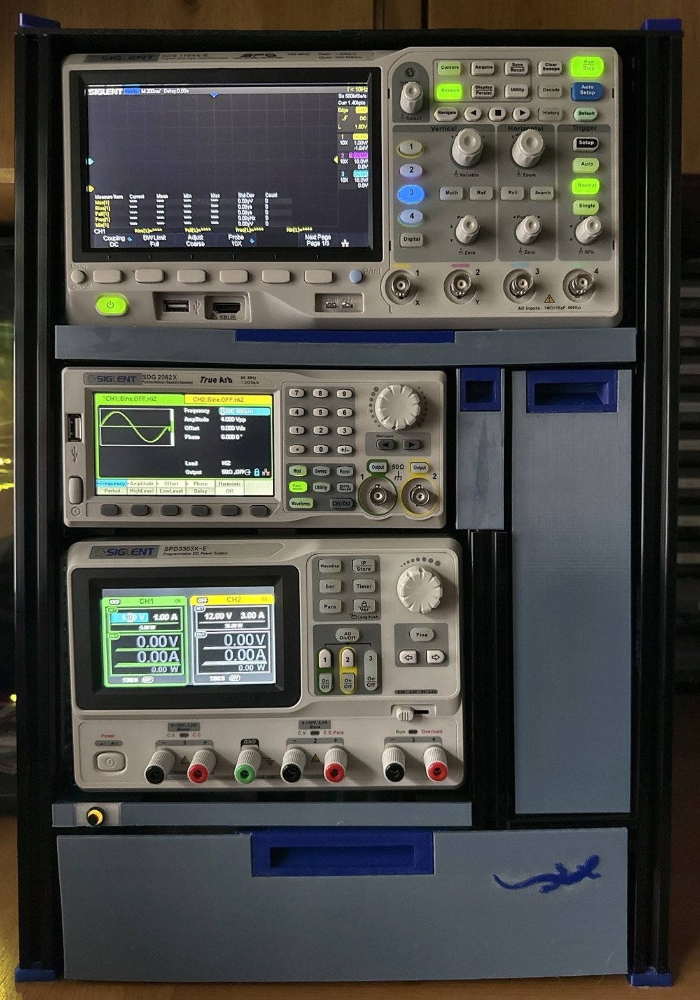

## The bench

My bench is 350 mm wide where the instruments go, with shelves directly above it, 60 mm free behind, and free to the right only along the front 250 mm of its depth. Three Siglent instruments had to live there — an SDS1104X-E oscilloscope, an SDG2082X waveform generator and an SPD3303X-E power supply — stacked, usable, with somewhere to keep leads and two multimeters. It did not need to move.

Those four facts decided most of the design before anything was drawn. The shelves above mean nothing can be lifted out, so every drawer, the scope and the storage have to come out forwards or to the right. The 60 mm behind takes the cables and the power strip and nothing else. The 250 mm of free bench to the right is where anything coming out sideways has to land, which turns out to be the number the whole scope sled is built round.

## Why an extrusion frame

The tower is 361 × 350 mm in plan and 510 mm tall before its feet and top panel, and it carries 13.5–13.9 kg of instruments. My printer's bed is 256 mm. A printed enclosure was out on both counts, so the structure is black 2020 aluminium extrusion — eight 1 m bars and a pack of four 300 mm ones, cut to length on a jig — and every interface on it is printed: cradles that seat the power supply's feet and the waveform generator's pads, three drawers on printed runners, a sled for the scope, a clip-on skin of hex-perforated tiles, a top panel, a fold-down door, feet.

Keeping the structure and the fits in different materials paid off twice. When the instruments first went in, three printed cradles clashed with them at once; the fix was six reprinted cradles, and the frame was not touched. Late in the build the lighting moved from a D1 mini running WLED to my own firmware on a XIAO ESP32-S3, with a new board and a new enclosure; again nothing in the frame or the cut sheet changed. The extrusion carries the weight and the printed parts carry every fit, so a fit can be wrong without the structure being wrong.

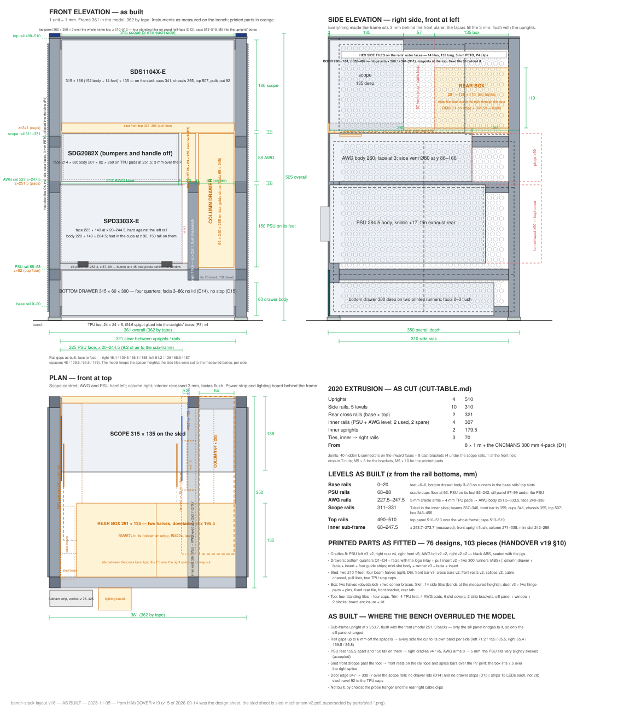

## The level stack

Everything hangs off five rail heights per side. The base rails sit on the bench; the power supply's rails are at 68–88 mm and its cradles put its feet at 91 so the body stands 91–241; the waveform generator's rails are at 227.5–247.5 with its pads lifting it to 251.5, 3 mm above the power supply's top; the scope rails are at 311–331 and carry the sled, whose beams run at 337–346 with the scope on them from 355 to 507; the top rails are at 490–510 and the top panel lies on them at 510–513. Three millimetres is the reveal between the power supply and the generator and between the scope and the top panel; the generator's bezel passes 1 mm under the sled beams; and the fronts all sit 3 mm behind the front plane with the drawer facias filling that reveal flush with the uprights.

The heights were meant to come from printed spacers stood on the rail below during assembly, and they did, within the accuracy of a frame bolted together by hand: when I put calipers on the finished frame on 2026-10-14 the gaps read 45.4 / 139.5 / 65.8 / 158 on the right and 51.2 / 135 / 65.5 / 157 on the left against a design of 48 / 139.5 / 63.5 / 159. That is up to 6 mm out and different per side, and it is why the side tiles — whose clip fingers fill a rail's slot mouth and must match their band to about 0.2 mm — were reprinted to the measured gaps, left and right as separate parts. The side tiles are the parts in this project that were cut to the frame, not to the drawing, and the build guide tells anyone building one to measure before they print them.

## Three parts worth looking at

### The scope sled and the box behind it

The scope is the one instrument I pull towards me, and the space behind it is the only storage big enough for two multimeters. Both of those collide with the bench: at home the box sits over y 195–330 of the frame's depth, which is inside the part of the bench that is blocked to the right, and the shelves rule out lifting it.

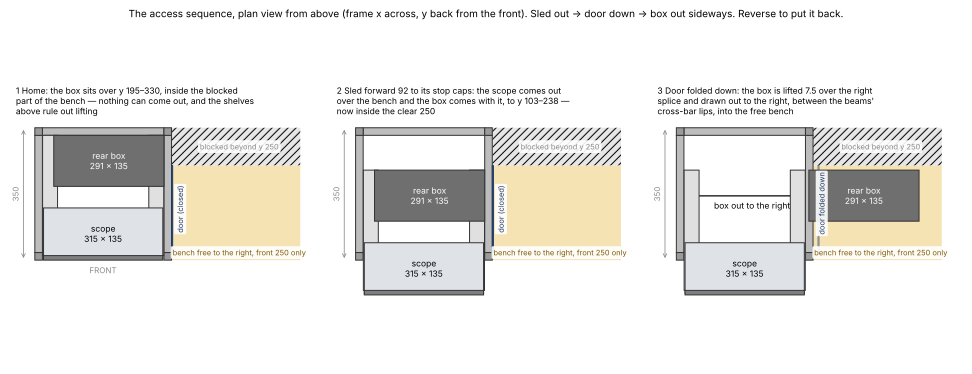

So the scope rides a sled, and the box rides the sled. Each beam of the sled sits on a 210 mm T-foot that runs in the scope rail's inner slot — the foot is the sliding pair, printed in ABS+ at 0.3 mm of slot clearance from the first coupon — and the two beams are tied into a ladder by a front bar and two cross bars. Pulling the scope forward 92 mm (100 of designed travel, less the 8 mm TPU stop caps) brings the box with it to y 103–238, inside the clear 250. Then the door on the right folds down past 180°, and the box lifts 7.5 mm over the right splice bar and draws out sideways between the cross bars' guide lips into the free bench. Reverse to put it back. I confirmed the whole sequence on the bench on 2026-10-23, and there is a [16-second clip of it](photos/access-sequence.gif).

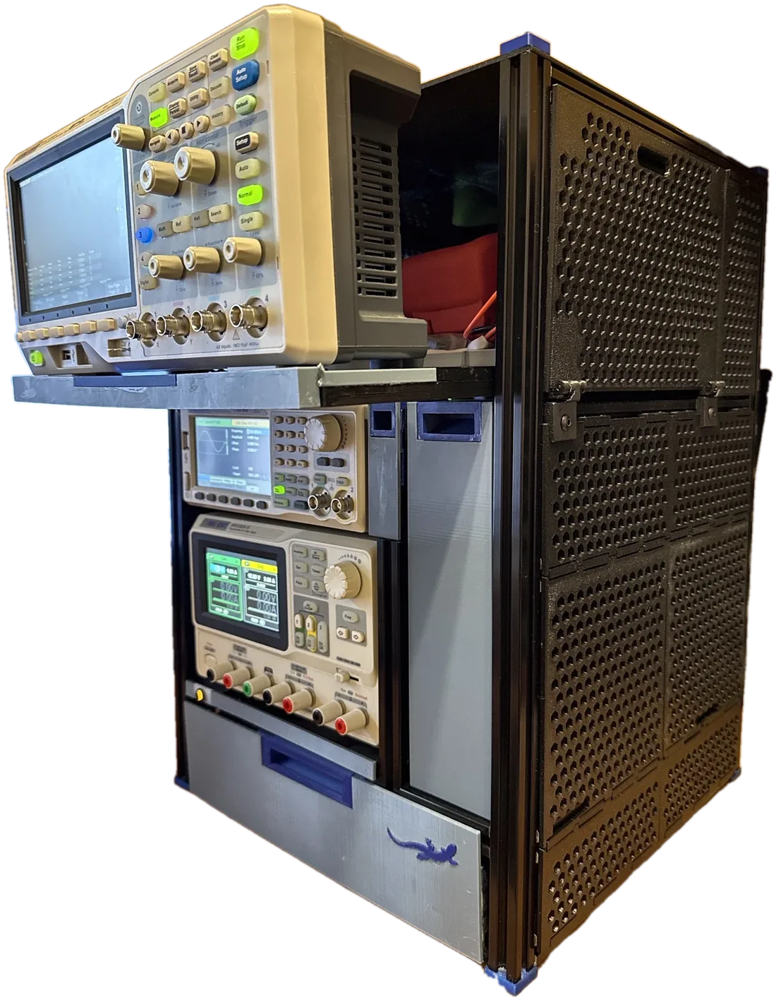
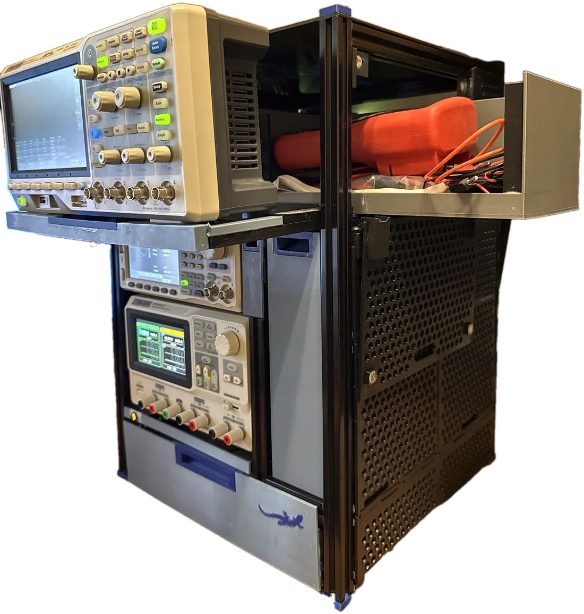

The sled took more iterations than anything else, and all of them were about stiffness. The bare beams leaned inwards under the scope, because its weight sits 45 mm inboard of each foot and nothing tied them; the front bar and cross bars were the designed answer and every one of their tabs is glued, since a dry tab's 0.15 mm of play is 0.8 mm at the scope's stands. Then the front sagged, mainly pulled out: the beam bends from where it leaves its foot, and the glued joint at y 165 — the beams are split there to fit the bed — is a hinge in bending. A front rest on each rail top, sized to the measured 3.0 mm rail-to-beam gap, carries the front; a 100 mm splice bar glued over each joint stiffens it. The splice's one cost is the 7.5 mm the box has to lift on its way out.

### The bottom drawer in four quarters

The bottom drawer is 315 × 300 × 60 mm — the full width of the frame and nearly its full depth — and there is no way to split that into two pieces that fit a 256 mm bed. So it is four quarters of 157.5 × 150, printed one per plate on four consecutive nights, and joined on the bench.

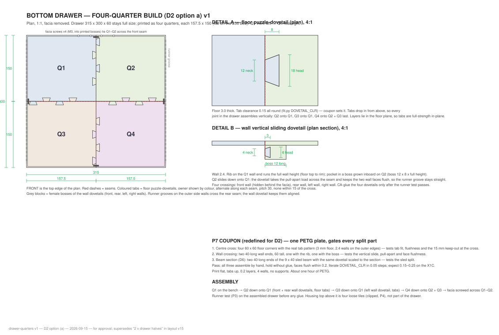

Along both seams the floors carry puzzle-shaped dovetail tabs — 12 mm neck, 18 mm head, 8 mm long, on a 30 mm pitch — alternating from one quarter to the other. At each of the four places where a wall crosses a seam there is a vertical sliding dovetail in a boss on the wall. Every joint assembles straight down: Q2 onto Q1, Q3 onto Q1, Q4 last onto both. The wall dovetails were glued only after the assembled drawer had run on its runners and proved it slid. The joint was coupon P7 before it was a drawer, and because it passed, the split sled beams and the two halves of the rear box use the same joint.

The drawer runs on two printed runners, each an L over the base rail with a 7 mm rib on its face, bolted down with four M5s so the bolts pull a 300 mm ABS+ print flat. A house-shaped groove in a boss along each side of the drawer rides the rib at 0.3 mm. There is no stop: at full travel the groove leaves the rib and the drawer comes off in the hand, which is also how it comes out. There is no lid either. Both were in the plan and both were dropped on the same evening, on the grounds that nearly every drawer in the world has neither.

### The mini slot and the fan it had to avoid

Beside the waveform generator, in the 26 mm between its right-hand side and the frame, there is a slot drawer 285 mm deep for probes and small leads. The generator's cooling fan vents out of that side — a Ø80 opening centred 123 mm behind its front face — and a 285 mm drawer runs straight past it.

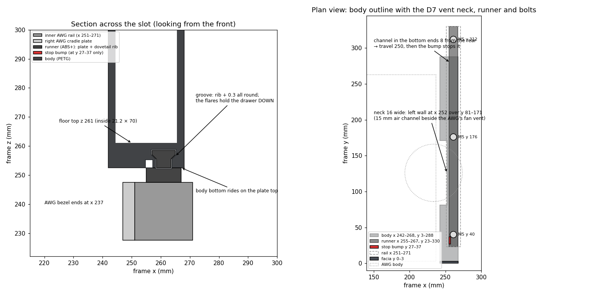

The first version of the slot was 180 deep purely to stop short of the vent. The one on the bench is 285 deep with a neck: its inner wall steps 10 mm outward over the 90 mm where the vent is, leaving a 15 mm air channel beside the fan, open upward into the layer under the scope and downward past the inner rail. It rides a single 12 mm runner on the inner rail's top with a dovetail rib holding it down when it is cantilevered 250 mm out. The design decision came with a test attached: all three instruments on for over an hour in the assembled tower, slot in, tiles on. The generator's fan was no louder than on the open bench and the slot's wall beside the exhaust was slightly warm, not hot. The fallback — reprint the slot at 85 deep — stayed on paper.

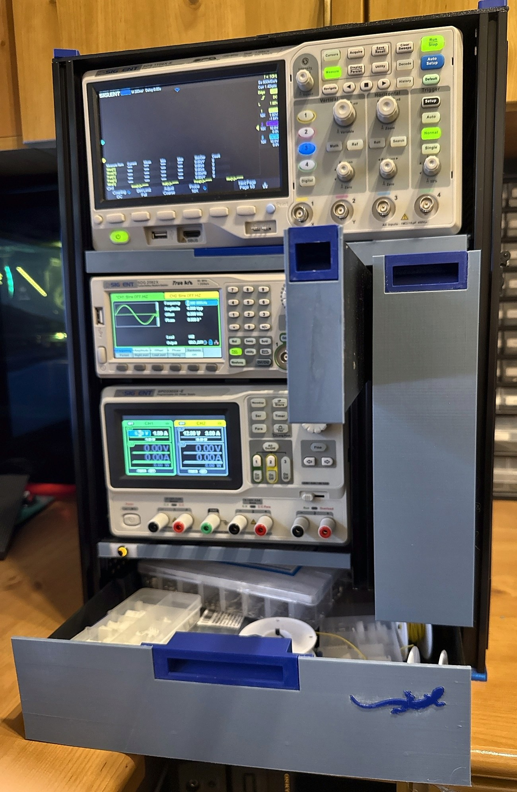

## Coupons before parts

Every part in the tower is a CadQuery script, and every script reads its clearances from one shared file, `fit.py`. Those numbers were not guessed. Nine coupons — short sections of the real parts, printed in the real orientation and tried on rail offcuts — set each one before the part that depended on it printed full size:

| Coupon | What it tried | What it found |
|---|---|---|
| P1 sled foot | a 40 mm T-foot in the rail slot, a beam stub on its rib | the third version was a little tight; a sweep of 0.3 / 0.4 / 0.5 picked 0.3, then confirmed in the ABS+ the real feet use |
| P2 cradle cup | the power supply's foot in a cup | a straight Ø21.6 bore gave 2 mm of slop on a foot that tapers from Ø16.8 to Ø21.5; the cup became a cone at 0.1 mm clearance and self-centres |
| P3 drawer runner | the rib and groove | the geometry passed at 0.3; the friction verdict waited for the 300 mm runners on the frame — they slide |
| P4 tile clip | a spring finger hooking a slot lip | barbs of 0.6 and 0.9 were both very loose; a 1.2 barb with a 45° hook holds |
| P5 hinge | a knuckle, a pin, a magnet pocket | the first one failed because it was a generic block, not a section of the door hinge; the second was cut from the production parts and passed with a 2.9 mm pin |
| P6 pull | the finger slot in a drawer front | 10 mm was too small for a thick finger; 12 is right and 14 is the ceiling the print allows |
| P7 quarter joint | the drawer's dovetails and the beam split | passed first time at 0.15 mm |
| P8 TPU foot | a spigot in the extrusion's bore, a slot cover | 4.6 mm holds the frame's weight; a 7.4 mm cover flare stays in by thumb |
| P9 bumper cup | the scope's rear foot in a cup | the handover said the bumper was Ø32; calipers said a D shape 25.9 × 24.0 at the rim, and the cup passed at 0.3 |

Three of those changed the design outright — P2, P4 and P9 — and P5's failure wrote the rule that a coupon is a literal section of the production part, in the production orientation, never a stand-in. Nothing printed full size until the coupon gating it had passed, with two exceptions I chose: P3's friction verdict was taken on the real runners because a short stub cannot tell you about stick-slip over 300 mm, and the TPU coupon rode in the one TPU session at the end because drying and hand-feeding TPU costs more than the parts.

Before any part went to the printer it was proven against the model of the frame and its neighbours by boolean intersection: zero cubic millimetres in place, then shifted 0.5 mm each way to show it is located and held, and for moving parts stepped through their travel. The sled was checked at every 10 mm of its 100; the door was swung through 180° in 15° steps against the rails, the tiles, the rest and the box's exit lane.

## The print rules

Fit on this printer depends on how a part sits on the bed. Vertical walls hold about ±0.05 mm; top surfaces are quantised to the layer height; ceilings sag. So the first decision about any part was which face goes down, and every precision surface was made a vertical wall in that orientation. The drawer fronts and the four top tiles — 3 mm sheets — print standing on edge so both faces are wall finish and nothing needs supporting. Nothing is supported inside any part: if the slicer preview showed support on a sliding or mating face, the design was wrong, not the slicer setting. A `printcheck.py` run on every export reports the resting face and any down-facing area before the STL is accepted.

The later rules carry dates, because each one was written the day a mistake taught it. Rule 10 (2026-09-22): no two identical pieces on a coupon plate. Rule 11 (same day): every variant stamped with its value — the 3.0 and 2.9 mm hinge pins came off the bed with nothing to tell them apart. Rule 12 (same day): TPU prints once, last. Rule 13 (2026-10-19): a chiral part is exported from the real frame, never from a mirrored check frame.

And one that is a setting rather than a rule: the 315 mm bottom-drawer front, printed on edge on the diagonal, warped at its ends and once failed into spaghetti. More heat and less speed fixed it — bed 80 °C, outer wall 60 mm/s, part fan capped at 30 %, a 15 mm brim with no gap, door closed — and those settings now sit on every thin standing part in the published project.

## What went wrong

The proofs catch geometry that is wrong against the model. They cannot catch the model being wrong, and they cannot catch things that are not in the model. The bench caught those.

A power-strip bracket's bolt hole was drawn on a workplane offset the wrong way, so it sat outside the 5 mm plate and cut nothing. Every copy printed without a hole; the fitted pair was drilled by hand. The script now asserts the hole exists.

The door set's fixed tile and magnet bracket were exported from the mirrored frame the tile checks use, and printed as the other hand — the tile's leg at the wrong end. The frame-leaf, tile and bracket were re-exported through a mirror-back step that prints a hand check, and rule 13 came out of it.

The sled's cross bars had their guide lips modelled exactly 135 mm apart — the box's own length — so the printed box would not drop between them. They now have 2 mm of play.

The sill block, which holds the lighting button and two pixels, went through ten versions, and two of them solved the wrong problem because I described the problem and the model answered a different one: v9 moved the pixels when it was the button's wires that would not fit. v10 is a 3.2 mm slit from the button's bore to the block's bottom face and a matching notch filed into the clear window, so the pre-wired button goes in from the front with its wires hanging through.

Each of these left something behind — an assertion, a rule, a clearance, a sheet — which is the part of the method that matters more than the proofs.

## The skin, the door and the top

The sides are 3 mm hex-perforated PETG tiles, 155 mm long, each with spring fingers on its back whose barbs hook under the lips of the rails' outer slots. Two tiles sharing a rail interleave their fingers, so the finger positions say which tile goes where, and a tile comes off only by angling it with a blade against a finger. The left band-2 and band-3 tiles have notches open to their bottom edges that fit round the cradle saddles standing on the rails.

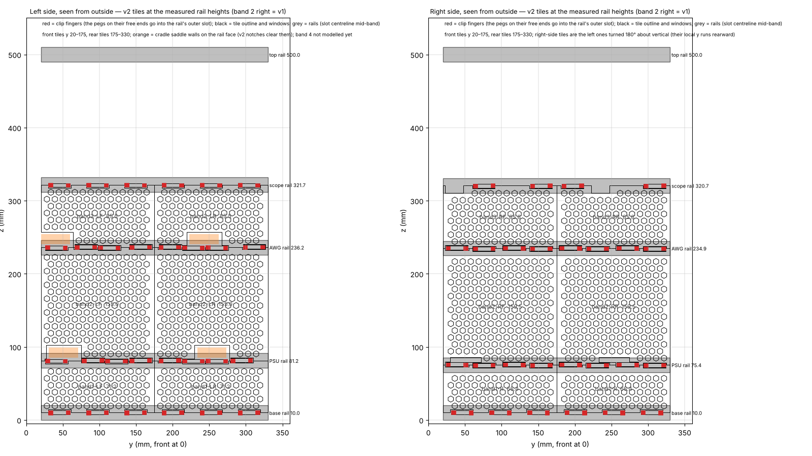

The fourth band on the right — the sled's level — is the door: 230 × 161 × 3, hung on two printed cranked hinges below its bottom edge so it opens downward past 180°, held at the top by two pairs of Ø10 × 2 magnets. The hinge axis had to move 7 mm outboard when the first check showed the barrel passing through the door panel, and the door's bottom edge came down 9 mm when I asked whether the band under it was doing anything (it was not). The fourth band on the left has no rail under it, so its two tiles hang from the top rail by their fingers and stand on a leg bolted to the upright.

The top is four 185.5 × 180 × 3 tiles printed standing, glued on the frame into one 362 × 350 sheet on 10 mm half-laps, held down at the corners by four dark blue caps whose M5s self-tap into the uprights' bores. Everything above the scope is 3 mm clear of it, sled home or out.

## The lighting

Two 15-LED WS2812B strips on the rear uprights' inner faces light the cavity behind the instruments, and it comes out through every hex tile. Two 5 mm pixels in the front sill light a clear window round an 8 mm button at the left end. The controller is a Seeed XIAO ESP32-S3 Plus on a 50 × 70 perfboard — a 74AHCT125 level shifter on both data lines, a Schottky on the XIAO's 5 V feed, a 1000 µF capacitor across the supply, crimped 2.54 mm locking plugs on every cable — in a printed vented enclosure on the rear base rail, fed from the power strip's USB port. Every wire but that one lives in an extrusion slot under a TPU cover.

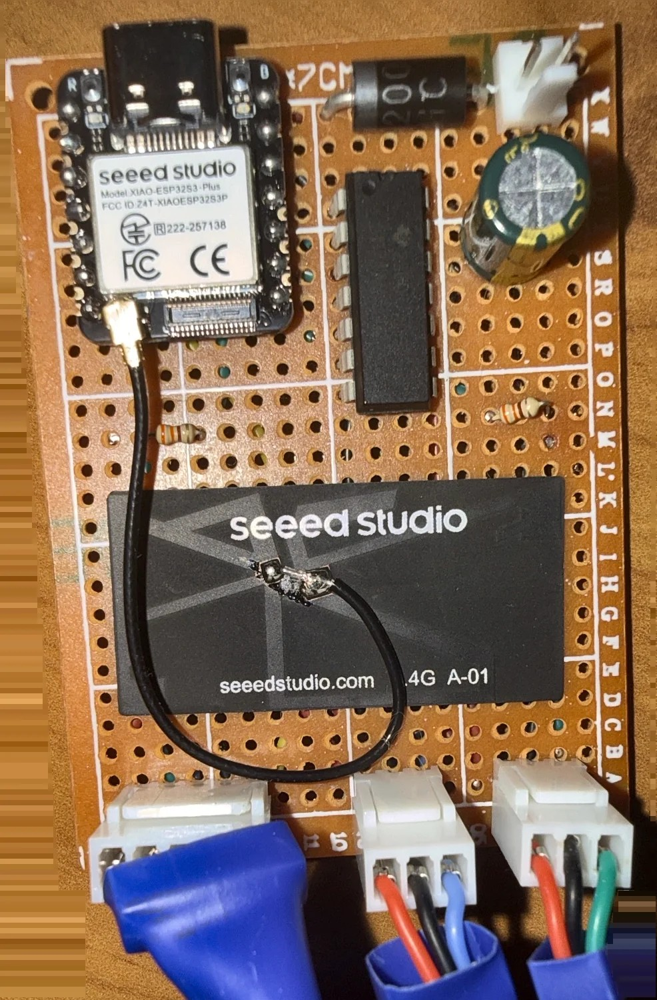

The firmware is **SiglentGlow**, my own, on the IguanaPlatform library that MorayGlow uses: captive-portal Wi-Fi setup, a web page, REST and WebSocket, Home Assistant over MQTT. The lighting went through five revisions on paper; rev 3 was a D1 mini running WLED, drawn and ready to build. I changed to my own firmware so the tower behaves like the rest of my devices, and because it only has to do what the tower needs: on and off, one colour and a brightness, remembered across power cycles, under a 1500 mA limit. The sill pixels double as status lights for booting, setup mode and the reset countdown.

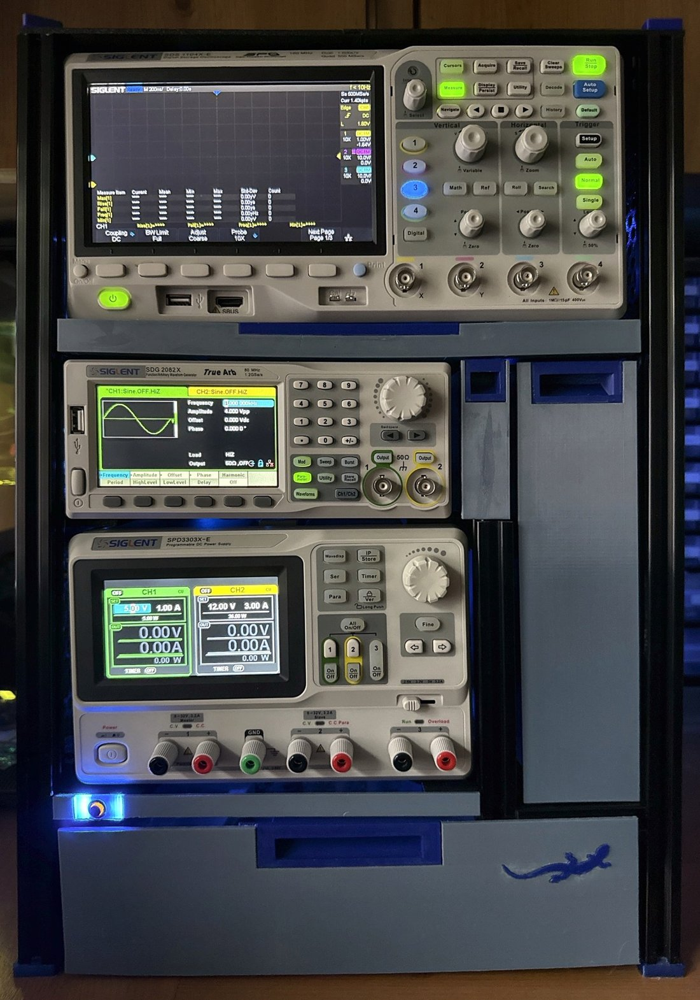

## The AI's part, honestly

Claude wrote every CadQuery script, every check sheet, the roadmap, the handover, the print rules, the build guide and this draft — in Cowork for the design and the sheets, in Claude Code for the firmware and the repository work. I measured, chose, printed, assembled and reported back from the bench, and I did not read the code. The division held for seven weeks because of three things: my measurements went straight into `fit.py`; nothing printed until its coupon had passed; and every print job came as a file in the repository with the print settings, the orientation and the check that would say whether it was right. When a fit was wrong the bench said so the same evening, and the roadmap — one document with tick boxes, kept in step with the bench every session — said what changed and why.

It made real mistakes, listed above, and the proofs caught none of them; the process did, because every part had a check sheet to look at and a test to pass on the bench. That is the honest summary: the modelling was fast and tireless and occasionally wrong in ways no amount of modelling would find, and the method was built so that being wrong cost a reprint, not a redesign.

## Where it stands

The build ran from 2026-09-15, the first coupon, to 2026-11-03, the lights on: seven weeks of evenings, one plate most nights. Seventy-six printed designs, 103 pieces, about 2.5 kg of filament in black ABS+, black ABS, black and dark grey and dark blue PETG, a few grams of clear PETG and some blue TPU. Forty hidden connectors, five cast brackets, about seventy M5s. Thirty-six plates in one Bambu Studio project, published on [MakerWorld](https://makerworld.com/en/models/3573243-siglenttower) with its sliced print profile, under the heading "ideas, not a kit": the parts fit the frame as it was cut and bolted, and anyone building one should expect to measure theirs and re-export the tiles.

Everything else is in the [repository](https://github.com/GarethCooke/SiglentTower): the scripts, the STLs, the sheets, the as-built record, a step-by-step [build guide](BUILD-GUIDE.md), and an [interactive 3D model](../bench-stack-3d.html) of the tower as built — drag to rotate; the sliders move the drawers, the sled, the box and the door.

*Design and documents CC BY 4.0, code MIT.*
